# VMC ECO-VENDO — User & Operator Guide

**Version:** `2.3.20`

VMC ECO-VENDO converts empty clear plastic bottles into timed WiFi internet access. Users connect to the hotspot, drop qualified empty bottles into the chute, and go online automatically.

> **Tip:** Click any image to view it full size.  
> **Printable Machine Poster:** [How to Connect Poster (PNG)](docs/VMC_EcoVendo_How_To_Connect_Infographic.png) · [Print-Ready PDF](docs/VMC_EcoVendo_How_To_Connect_Infographic.pdf)

---

## Table of Contents

- [Part I — Customer WiFi Guide](#part-i--customer-wifi-guide)
  1. [Quick Visual Guide (How to Connect Poster)](#1-quick-visual-guide-how-to-connect-poster)
  2. [Joining WiFi & Reading the Screen](#2-joining-wifi--reading-the-screen)
  3. [What Bottles Are Allowed vs. Not Allowed](#3-what-bottles-are-allowed-vs-not-allowed)
  4. [Inserting Bottles & Rejection Alerts](#4-inserting-bottles--rejection-alerts)
  5. [Using Your Time, Pausing & Resuming](#5-using-your-time-pausing--resuming)
  6. [Using a Prepaid Voucher Code](#6-using-a-prepaid-voucher-code)
  7. [Sharing Minutes with Another Device](#7-sharing-minutes-with-another-device)
  8. [Troubleshooting for Users](#8-troubleshooting-for-users)
- [Part II — Machine Owner & Operator Manual](#part-ii--machine-owner--operator-manual)
  1. [Signing In to the Owner Dashboard](#1-signing-in-to-the-owner-dashboard)
  2. [Vendo Operations](#2-vendo-operations)
     - [Dashboard & Stats](#dashboard--stats)
     - [Active Clients](#active-clients)
     - [Voucher Tickets](#voucher-tickets)
     - [Rates & Packages](#rates--packages)
     - [Validity & Pauses](#validity--pauses)
  3. [Network & Traffic](#3-network--traffic)
     - [Adapters & Internet/WiFi Ports](#adapters--internetwifi-ports)
     - [Pop-Up Address & Name Settings](#pop-up-address--name-settings)
     - [Connected Device Addresses](#connected-device-addresses)
     - [Router & Hotspot Protection](#router--hotspot-protection)
     - [Speed Limits & Online Game Priority](#speed-limits--online-game-priority)
     - [Free Websites (No Time Needed)](#free-websites-no-time-needed)
     - [VIP Free Devices & Blocked Devices](#vip-free-devices--blocked-devices)
  4. [Portal & Branding](#4-portal--branding)
     - [Portal & Banners](#portal--banners)
     - [Audio & Chimes](#audio--chimes)
  5. [Hardware & Sensors](#5-hardware--sensors)
     - [Chute Sequence Monitor](#chute-sequence-monitor)
     - [Light Sensor for Clear Plastic](#light-sensor-for-clear-plastic)
     - [Weight Sensor (Digital Scale)](#weight-sensor-digital-scale)
     - [Metal & Cans (Metal Detector)](#metal--cans-metal-detector)
     - [Gate & Drop Motors](#gate--drop-motors)
     - [Timers & Full-Bin Sensor](#timers--full-bin-sensor)
  6. [System & Maintenance](#6-system--maintenance)
     - [Telegram Phone Alerts](#telegram-phone-alerts)
     - [System Health Check](#system-health-check)
     - [Backup, Restore & Reset Data](#backup-restore--reset-data)
     - [Restart & Safe Power Off](#restart--safe-power-off)
     - [System Activity Logs](#system-activity-logs)
     - [Machine License & Remote Support](#machine-license--remote-support)
- [Reference Files](#reference-files)

---

# Part I — Customer WiFi Guide

Connect your phone or laptop to the Eco-Vendo WiFi hotspot. The welcome page usually pops up automatically. If it does not open on its own, open a web browser (Chrome, Safari, etc.) and go to **`http://10.0.0.1/`**.

---

## 1. Quick Visual Guide (How to Connect Poster)

  <a href="docs/VMC_EcoVendo_How_To_Connect_Infographic.pdf">
    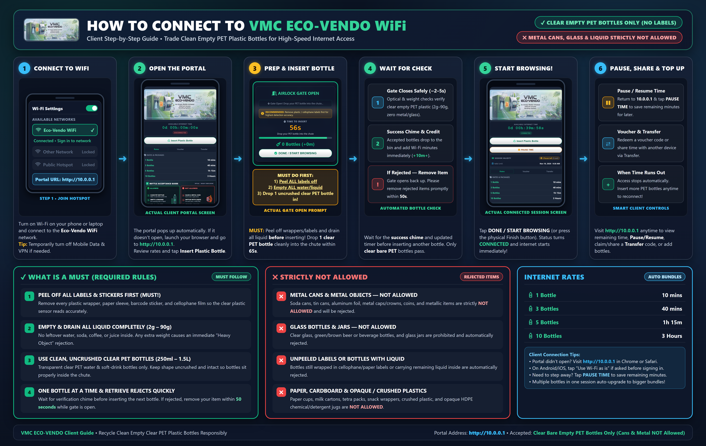
  </a>

- **Print for Machine Display:** [High-Resolution Tarpaulin Poster (PDF)](docs/VMC_EcoVendo_How_To_Connect_Infographic.pdf)
- **Before You Drop:** Peel off the wrapper label and pour out any leftover liquid. **Glass bottles and non-accepted items will be rejected.**

---

## 2. Joining WiFi & Reading the Screen

<table>
  <tr>
    <td width="265" align="center" valign="top">
      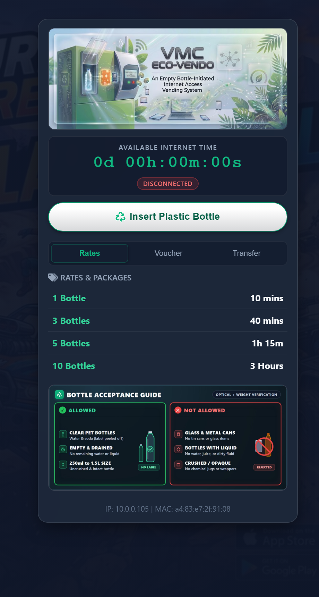
    </td>
    <td valign="top">
      
The machine display and your phone screen guide you through each step:

      <ul>
        <li><strong>Machine Front Screen (LCD):</strong> When nobody is using the chute, the small screen on the front of the machine cycles current bottle-to-minute rates alongside a scrolling <strong>HOW TO CONNECT WIFI</strong> quick guide (<code>1. Connect WiFi</code> &rarr; <code>2. Open 10.0.0.1</code> &rarr; <code>3. Drop Bottle</code> &rarr; <code>4. Get WiFi</code>).</li>
        <li><strong>Top Banner:</strong> Shows the hotspot name (for example, <strong>VMC ECO-VENDO</strong>) and any announcement posted by the machine owner.</li>
        <li><strong>AVAILABLE INTERNET TIME:</strong> Displays remaining time as Days, Hours, Minutes, and Seconds (<code>0d 00h:00m:00s</code>), plus your current connection status:
          <ul>
            <li><code>DISCONNECTED</code> — No active WiFi balance yet.</li>
            <li><code>CONNECTED</code> — Online with active time counting down.</li>
            <li><code>PAUSED</code> — Remaining balance safely saved on hold.</li>
          </ul>
        </li>
        <li><strong>Insert Plastic Bottle:</strong> Unlocks and opens the bottle chute door.</li>
        <li><strong>Rates / Voucher / Transfer Tabs:</strong> View bottle-to-minute promos, enter a prepaid voucher code, or send minutes to another device.</li>
        <li><strong>Bottle Acceptance Guide:</strong> Quick summary at the bottom showing accepted vs. rejected items.</li>
        <li><strong>Footer IP &amp; Device ID:</strong> Shows your temporary WiFi IP address (<code>10.0.0.x</code>) and hardware MAC ID for troubleshooting.</li>
      </ul>
    </td>
  </tr>
</table>

---

## 3. What Bottles Are Allowed vs. Not Allowed

To make sure your bottle is accepted right away:

- **Peel Labels & Empty Liquid First:**  
  Remove any **plastic, cellophane, or paper wrapper label** before dropping the bottle in. Labels block and scatter the optical sensor beam and can trigger a rejection. Pour out every drop of water or drink.
- **ACCEPTED:**
  - Empty, clean, clear plastic water or soft-drink bottles (**`250 ml` to `1.5 L`**).
  - Dry, uncrushed, and still holding their normal bottle shape (do not flatten them).
  - Clean empty aluminum drink cans are accepted **only if** the machine owner turned on Metal Can mode.
- **NOT ACCEPTED (Will Be Rejected):**
  - **Metal cans or foil** (when in standard Plastic Bottles Only mode).
  - **Glass bottles** (clear or colored).
  - Bottles still containing liquid, sand, mud, or stones.
  - Crushed/flattened bottles, cloudy/solid white plastic jugs, paper cups, or cardboard.

---

## 4. Inserting Bottles & Rejection Alerts

<table>
  <tr>
    <td width="265" align="center" valign="top">
      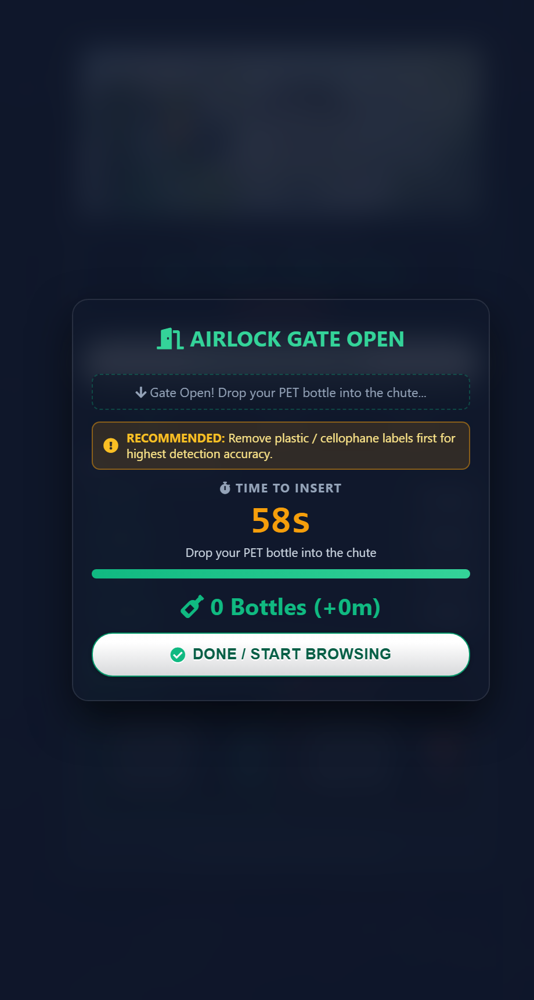
    </td>
    <td valign="top">
      <ol>
        <li>Peel off the wrapper label and drain all liquid from your bottle.</li>
        <li>Tap <strong>Insert Plastic Bottle</strong> on your phone.</li>
        <li>Wait for the <strong>AIRLOCK GATE OPEN</strong> pop-up window (shows the label reminder and countdown timer, <code>65s</code> default).</li>
        <li>Slide <strong>one empty bottle at a time</strong> into the chute opening and let go.</li>
        <li>Wait a few seconds while the door closes and checks the bottle. A chime plays when accepted and adds to your counter (e.g., <strong><code>1 Bottle (+10m)</code></strong>). You can drop additional bottles right after the door reopens.</li>
        <li><strong>If an item is rejected:</strong> The machine sounds an alert tone, reopens the door (you have <code>50s</code> to remove the item), and shows why—such as <strong>metal detected</strong>, <strong>too heavy</strong> (leftover water), <strong>too light</strong>, or <strong>not clear plastic</strong>.</li>
        <li>Tap <strong>DONE / START BROWSING</strong> when finished to close the chute door and go online immediately.</li>
      </ol>
    </td>
  </tr>
</table>

---

## 5. Using Your Time, Pausing & Resuming

### While Connected (`CONNECTED`)

<table>
  <tr>
    <td width="265" align="center" valign="top">
      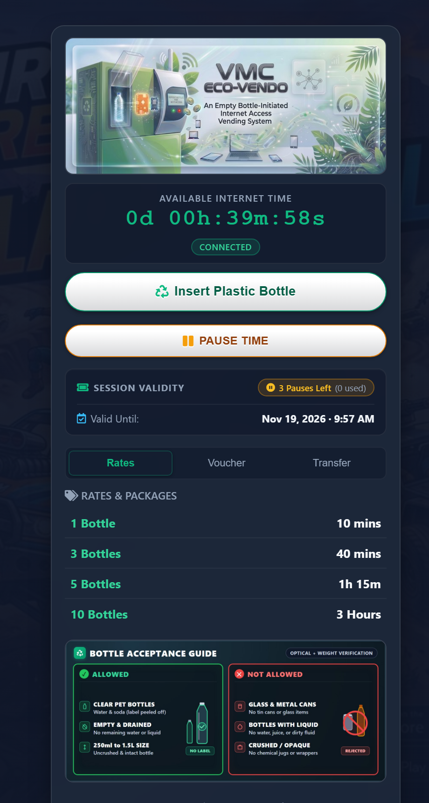
    </td>
    <td valign="top">
      
After your deposit finishes, the status badge turns green (<strong><code>CONNECTED</code></strong>) and your phone has full internet access.

      <ul>
        <li><strong>SESSION VALIDITY:</strong> Displays remaining pauses (for example, <code>3 Pauses Left</code>) and when your balance expires (<strong><code>Valid Until</code></strong>).</li>
        <li><strong>PAUSE TIME:</strong> Tap this before locking your phone or stepping away so your minutes stay saved instead of ticking down. Inserting another bottle later tops up your timer and resets your pause count.</li>
      </ul>
    </td>
  </tr>
</table>

### While Paused (`PAUSED`)

<table>
  <tr>
    <td width="265" align="center" valign="top">
      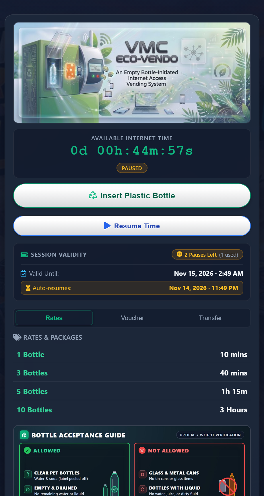
    </td>
    <td valign="top">
      
When your session is on hold:

      <ul>
        <li>Internet access pauses and your remaining time freezes.</li>
        <li><strong>Pause Limit:</strong> The <strong>SESSION VALIDITY</strong> panel displays how long a pause can last before resuming automatically (or expiring, depending on owner settings).</li>
        <li><strong>Resume Time:</strong> Tap this whenever you want to continue browsing.</li>
      </ul>
    </td>
  </tr>
</table>

---

## 6. Using a Prepaid Voucher Code

<table>
  <tr>
    <td width="265" align="center" valign="top">
      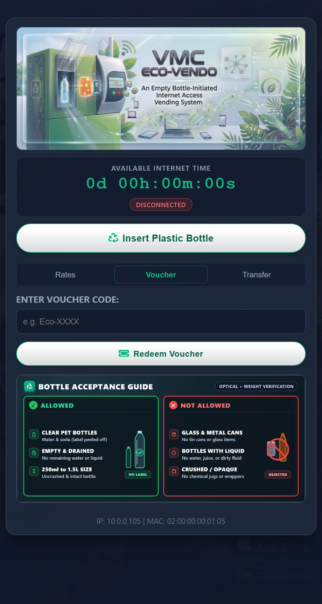
    </td>
    <td valign="top">
      
If you have a printed voucher code from the machine owner:

      <ol>
        <li>Open the <strong>Voucher</strong> tab below the main button.</li>
        <li>Enter the 8-character voucher code carefully.</li>
        <li>Tap <strong>Redeem Voucher</strong> to add the minutes straight to your phone.</li>
      </ol>
    </td>
  </tr>
</table>

---

## 7. Sharing Minutes with Another Device

<table>
  <tr>
    <td width="265" align="center" valign="top">
      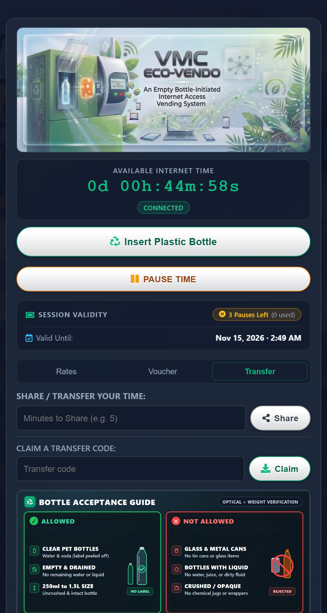
    </td>
    <td valign="top">
      
Send part or all of your remaining minutes to another phone or laptop connected to the same hotspot:

      
<strong>Step A — Create a Transfer Code (Sending Device)</strong>

      <ol>
        <li>Open the <strong>Transfer</strong> tab.</li>
        <li>Enter the minutes you want to share and create a one-time transfer code.</li>
      </ol>
      
<strong>Step B — Claim Minutes (Receiving Device)</strong>

      <ol>
        <li>Join the same Eco-Vendo WiFi on the second device and open <code>http://10.0.0.1/</code> &rarr; <strong>Transfer</strong>.</li>
        <li>Type the transfer code under <strong>Claim a Transfer Code</strong> and submit.</li>
      </ol>
    </td>
  </tr>
</table>

---

## 8. Troubleshooting for Users

- **Welcome screen did not appear automatically:** Turn **Mobile Data OFF**, make sure you are connected to the Eco-Vendo WiFi, and open **`http://10.0.0.1/`** in Chrome or Safari.
- **Brief disconnect right after tapping `DONE` or `Resume Time`:** This happens for 1–2 seconds while your device switches from captive login mode to full internet access. Wait two seconds and refresh.
- **Clear plastic bottle was rejected:** Confirm that the **wrapper label is peeled off**, **no water remains inside**, the bottle is **not crushed flat**, and no **metal cap/ring** is attached.

---

# Part II — Machine Owner & Operator Manual

Open the owner control panel on any device connected to the station network at **`http://10.0.0.1/admin`**.

The sidebar organizes all settings into **five groups**:
1. **VENDO OPERATIONS** — Dashboard stats, active clients, vouchers, rates, and validity/pause rules.
2. **NETWORK & TRAFFIC** — WAN/LAN ports, captive pop-up DNS, connected leases, router guards, speed limits, game priority, free sites, and MAC filtering.
3. **PORTAL & BRANDING** — Station title, banners, announcements, and speaker sound effects.
4. **HARDWARE & SENSORS** — Chute sequence monitor, plastic light sensor, scale, metal can mode, door motors, and chute timers.
5. **SYSTEM & MAINTENANCE** — Telegram phone alerts, health verifier, backups & selective data reset, power actions, activity logs, and licensing.

---

## 1. Signing In to the Owner Dashboard

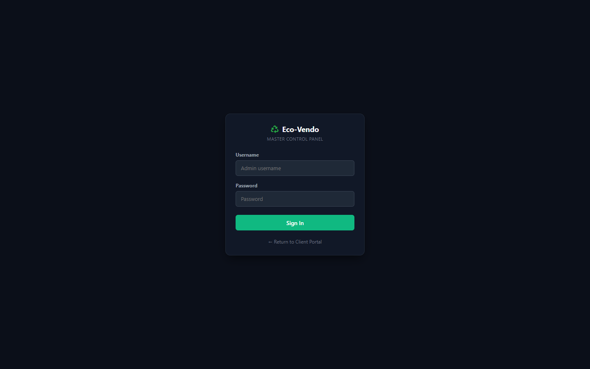

1. Open **`http://10.0.0.1/admin`** in your web browser.
2. Sign in with your owner credentials:
   - **Fresh Default Username:** `admin`
   - **Fresh Default Password:** `admin1234`
3. **First-Time Password Change:** The first time you log in with the factory default password (`admin1234`), the system automatically prompts you to set your own custom password before allowing access to any controls. Keep your updated password in a safe place.

---

## 2. Vendo Operations

### Dashboard & Stats

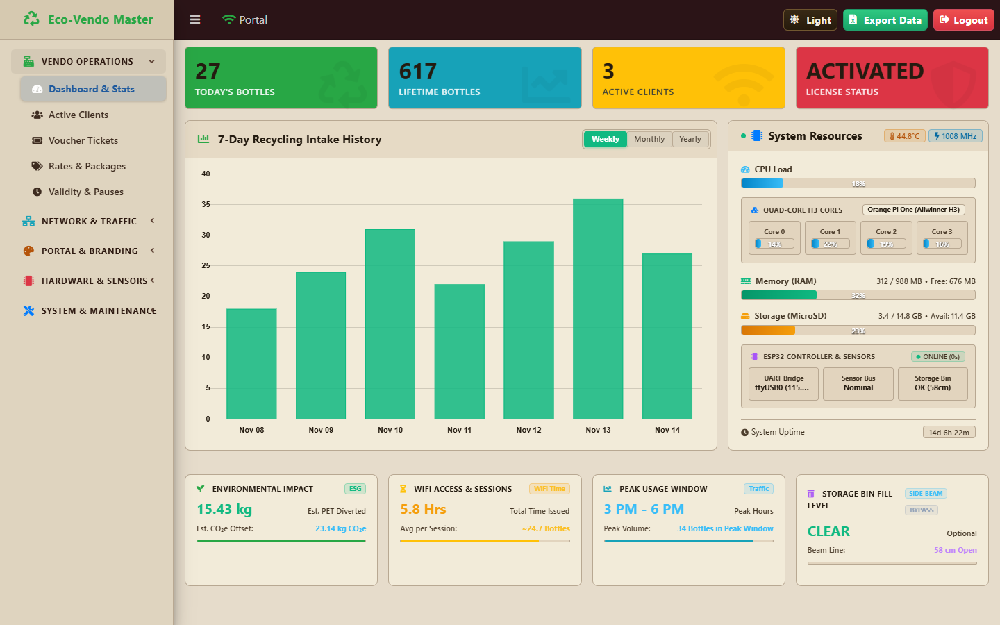

The home dashboard tracks live activity and machine health at a glance:
- **Top KPI Cards:** `Today's Bottles`, `Lifetime Bottles`, `Active Clients`, and `License Status`.
- **Recycling Intake Chart:** Toggle between **Weekly** (`7-Day`), **Monthly** (`30-Day`), and **Yearly** (`12-Month`) bars, or click **`Reset Data`** right beside the range switcher to clear operational counters (with a confirmation check).
- **System Resources:** Shows Orange Pi CPU load, temperature, RAM, SD storage space, uptime, and live link status to the ESP32 sensor board.
- **Bottom Summary Cards:** `Environmental Impact` (estimated plastic diverted & CO₂ offset), `WiFi Access & Sessions` (total time granted & average bottles per session), `Peak Usage Window`, and live `Storage Bin Fill Level`.

---

### Active Clients

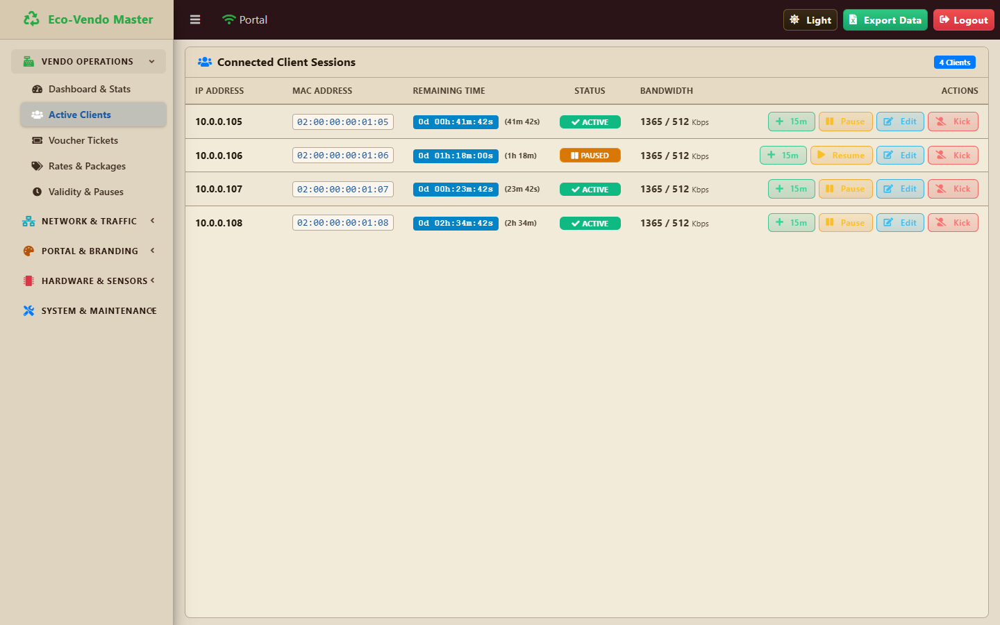

View and control all connected or paused users:
- Displays each device's **IP Address**, **MAC Address**, **Remaining Time**, **Status** (`ACTIVE`, `PAUSED`, `PAID`), and **Bandwidth Limit**.
- Per-client controls (destructive actions ask for confirmation first):
  - **`+15m`**: Immediately add 15 minutes.
  - **`Pause` / `Resume`**: Freeze or restart a client's WiFi timer.
  - **`Edit`**: Adjust remaining minutes directly.
  - **`Kick`**: Disconnect the client and end their active session.

---

### Voucher Tickets

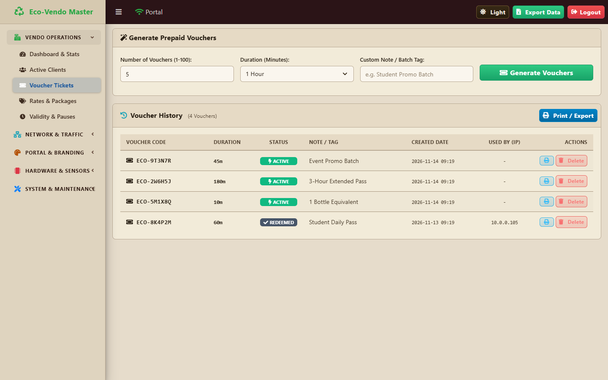

Generate and manage prepaid WiFi ticket codes:
- **Generate Vouchers:** Pick quantity (`1–100`), duration in minutes, and an optional batch label.
- **Voucher History:** Filter between active/unused and redeemed vouchers, see redemption timestamps and device IDs, and delete individual tickets.
- **Print / Export:** Print ticket slips or export voucher batches to Excel.

---

### Rates & Packages

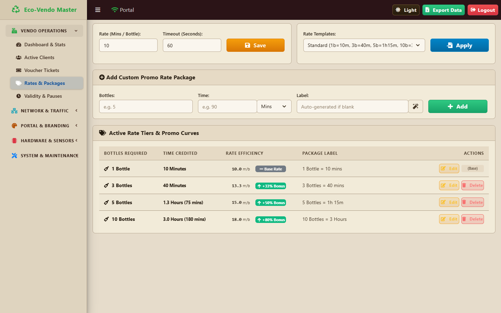

Configure how much WiFi time bottles earn:
- **Base Settings:** Standard **Minutes per Bottle** and the main **Drop Timeout** wait window.
- **Presets:** Apply ready-made rate profiles (**Standard**, **Aggressive**, or **Cafe**) in one click.
- **Bonus Bundles:** Set tiered multi-bottle rewards (such as `1 Bottle = 10 mins`, `3 Bottles = 40 mins`, `5 Bottles = 1h 15m`, `10 Bottles = 3 Hours`), showing percentage savings automatically.

---

### Validity & Pauses

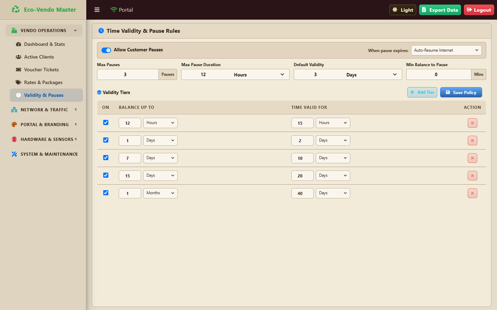

Set balance expiration windows and pause limits:
- **Allow Customer Pauses:** Enable or disable the customer pause button.
- **Max Pauses:** Set how many times a user can pause per deposit (inserting another bottle automatically resets their pause counter).
- **Pause Hold Limit & Expiry Behavior:** Choose how long a user can remain paused before auto-resuming or expiring.
- **Validity Brackets:** Set minimum balance required to pause and assign longer expiration deadlines to larger minute balances.

---

## 3. Network & Traffic

Open **Network & Interfaces** to configure **Adapters & WAN/LAN**, **DNS & Domain**, **DHCP & Leases**, and **Access Policies**, plus **Bandwidth & Speed**, **Walled Garden Sites**, and **MAC Filtering**.

### Adapters & Internet/WiFi Ports

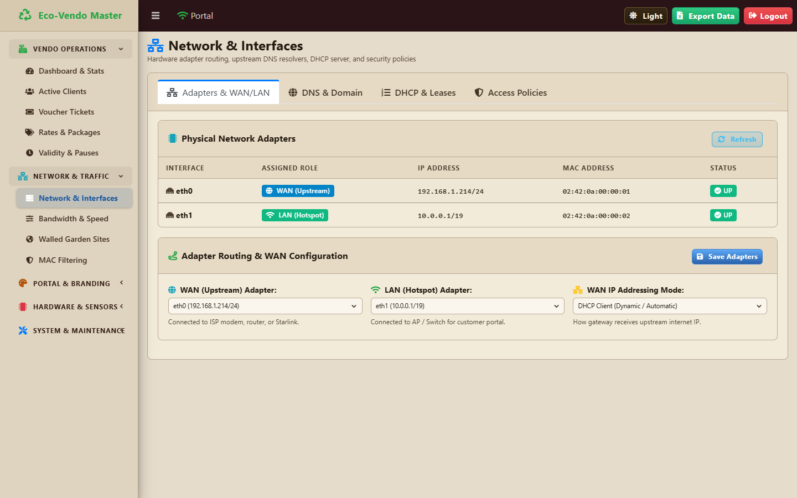

Select which Ethernet port carries incoming internet (`WAN`) and which port feeds the customer WiFi access point (`LAN`, gateway `10.0.0.1`). Live traffic throughput and cable link states appear in real time.

---

### Pop-Up Address & Name Settings

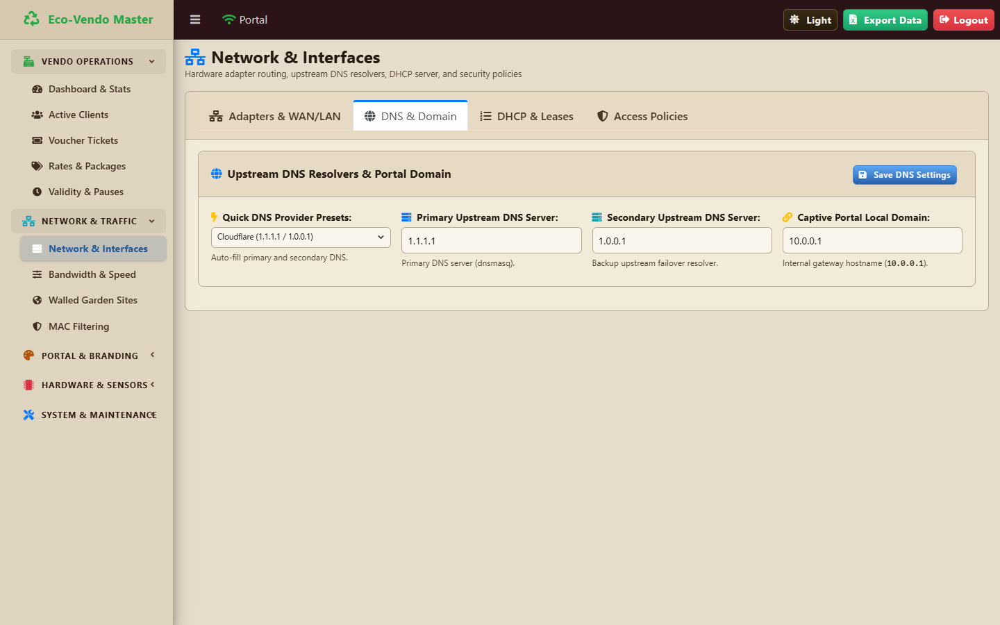

Manages local hotspot DNS resolution and captive-portal auto-popup behavior so iOS, Android, and Windows devices open the welcome screen automatically upon joining WiFi (including disabling iCloud Private Relay prompts on the captive portal network).

---

### Connected Device Addresses

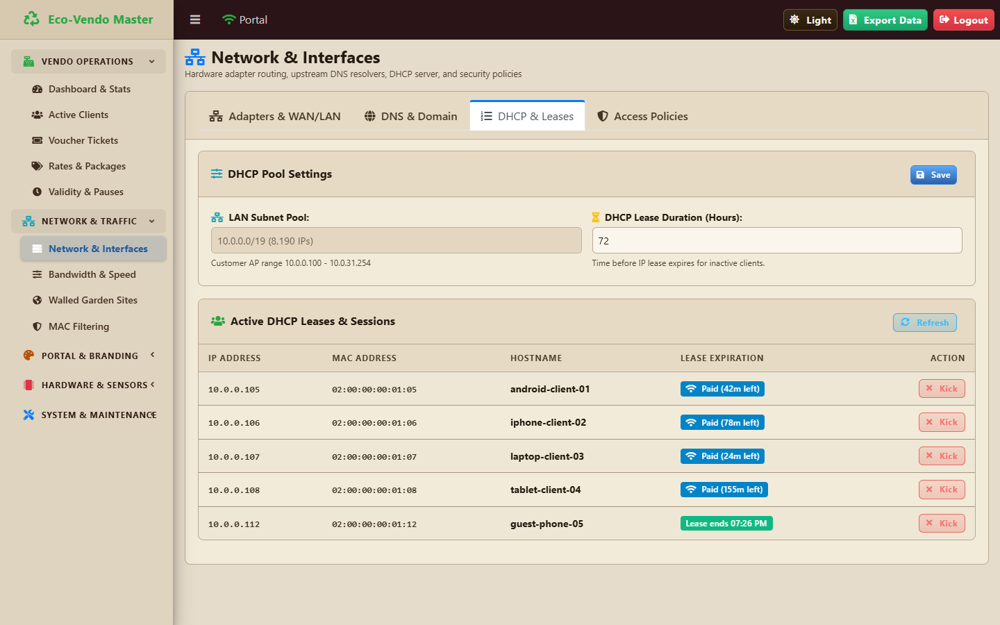

Shows every phone and laptop holding a hotspot DHCP address (**`10.0.0.100` to `10.0.31.254`**, over 8,000 leases), including hostname, IP/MAC address, and status (`Paid` vs `Unauthenticated`).

---

### Router & Hotspot Protection

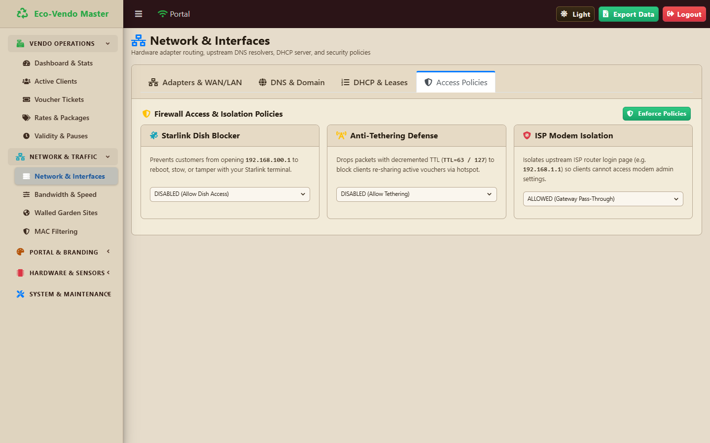

One-click network protection toggles:
- **ISP Modem Isolation:** Blocks customers from reaching your upstream ISP modem/router admin login page.
- **Starlink Blocker:** Blocks access to the Starlink dish configuration address (`192.168.100.1`).
- **Anti-Hotspot-Sharing:** Helps prevent connected users from tethering or sharing one WiFi session to extra devices.

---

### Speed Limits & Online Game Priority

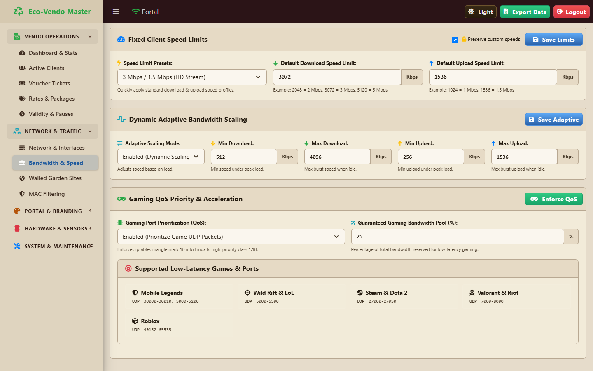

Manage internet speeds across all users:
- **Default Download / Upload Limits:** Cap per-device speeds so large downloads do not slow down everyone else.
- **Dynamic Speed Scaling:** Optionally reduce per-device caps automatically as more users go online at once.
- **Gaming QoS Priority:** Gives priority routing to latency-sensitive game traffic (**Mobile Legends**, **League of Legends / Wild Rift**, **Valorant**, **Dota 2 / Steam**, and **Roblox**) so ping stays low during heavy browsing.

---

### Free Websites (No Time Needed)

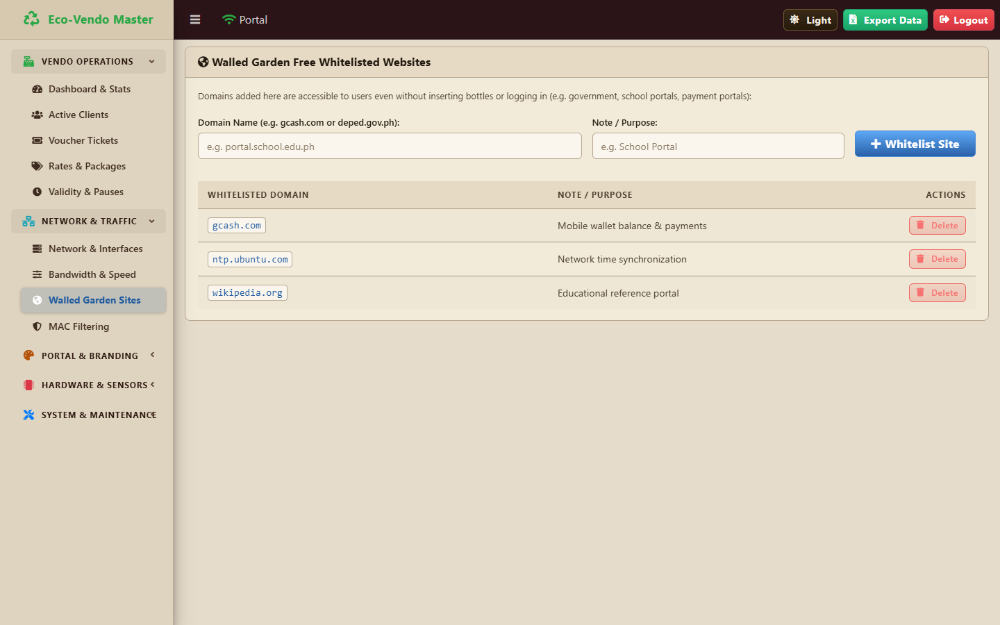

Whitelist specific trusted domain names that connected devices can visit without any WiFi balance (for example, a school portal or station help page).

---

### VIP Free Devices & Blocked Devices

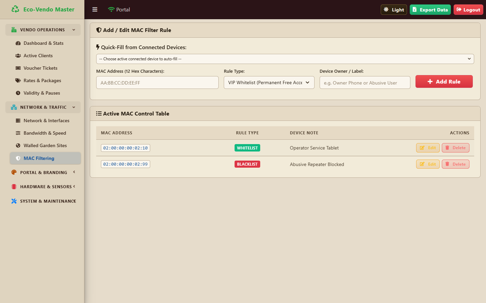

Manage special devices by MAC address:
- **VIP Whitelist:** Grant permanent free internet access to owner phones, maintenance tablets, or info kiosks.
- **Blacklist:** Permanently block abusive or banned devices.
- **Quick-Fill Picker:** Choose an already connected device from the dropdown instead of typing its MAC address manually.

---

## 4. Portal & Branding

### Portal & Banners

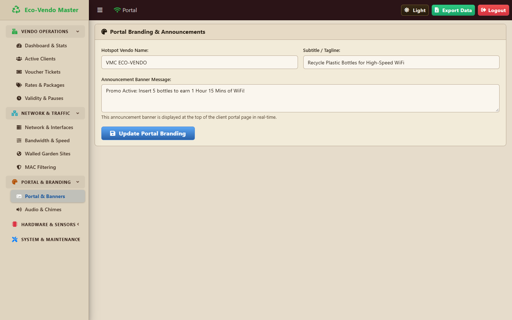

Customize the customer welcome page wording:
- **Vendo Title:** Main station heading shown at the top of the portal.
- **Tagline / Subtitle:** Short text displayed right under the title.
- **Announcement Banner:** Highlighted top notice for promos or maintenance reminders.

---

### Audio & Chimes

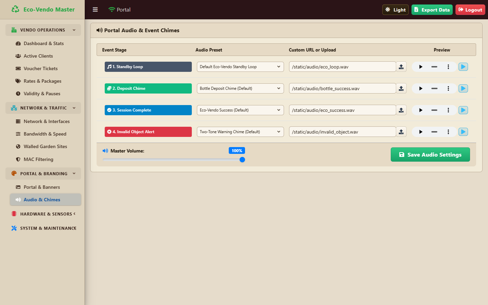

Configure speaker audio feedback for **4 events**:
1. **Standby Loop:** Background/idle sound.
2. **Deposit Chime:** Plays immediately after a bottle clears every sensor and earns minutes.
3. **Session Complete:** Plays when the user taps `DONE / START BROWSING`.
4. **Invalid Object Alert:** Error tone when a non-qualified item is rejected.

Pick built-in audio files or upload custom `.wav`/`.mp3` clips, preview each sound live, and control **Master Volume**.

---

## 5. Hardware & Sensors

The **ESP32 Hardware** section lets you monitor every stage of the chute live, calibrate sensors, configure optional metal can acceptance, test doors, and adjust wait timers.

---

### Chute Sequence Monitor

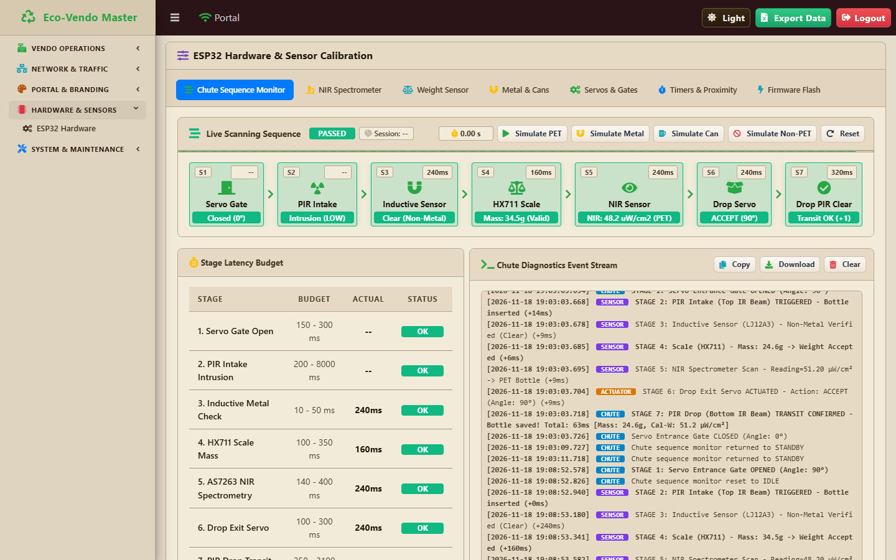

Track each deposit live through **7 stages (`S1` to `S7`)**:
1. **`S1` Servo Gate:** Entrance door opens so a bottle can be inserted.
2. **`S2` Top IR Sensor:** Detects the bottle entering and closes the entrance door.
3. **`S3` Inductive Sensor:** Checks continuously for metal while the bottle slides down and settles.
4. **`S4` Weight Scale:** Measures mass in grams to catch liquid-filled bottles or heavy debris.
5. **`S5` Clear Plastic Light Sensor:** Verifies clear PET material (bypassed only for empty cans when Metal Can mode is turned on).
6. **`S6` Drop Door:** Tilts open (`90°`) to drop an accepted bottle into the collection bin, or holds shut and reopens the entrance door if rejected.
7. **`S7` Bottom Drop Sensor:** Confirms the accepted bottle dropped cleanly into the bin before awarding minutes.

Use the **Stage Latency Budget** table and **Chute Diagnostics Event Stream** log below to inspect sensor timings and exact verdicts for each item.

---

### Light Sensor for Clear Plastic

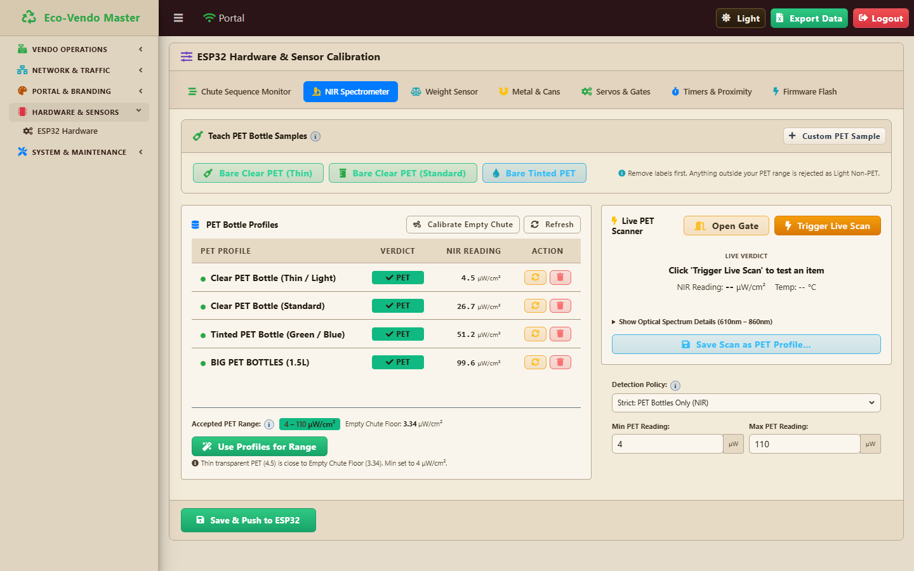

Tune the **AS7263 optical sensor** used to distinguish clear PET plastic from glass, paper, or dark trash:
- **Default Accepted Range:** **`4 – 110 uW/cm²`** (empty chute baseline around **`3.34 uW/cm²`**). Colored glass absorbs light below the floor; paper and cardboard scatter strongly above the upper limit.
- **Reference Profiles:** Includes 4 pre-tested bottle profiles (`Clear PET Thin 4.5`, `Standard 26.7`, `Tinted 51.2`, `BIG 1.5L 99.6`).
- **Live Calibration:** Click **`Open Gate`** to place a bottle inside, run **`Trigger Live Scan`**, and adjust via **`Use Profiles for Range`** or **`Calibrate Empty Chute`**, then click **`Save & Push to ESP32`**.

---

### Weight Sensor (Digital Scale)

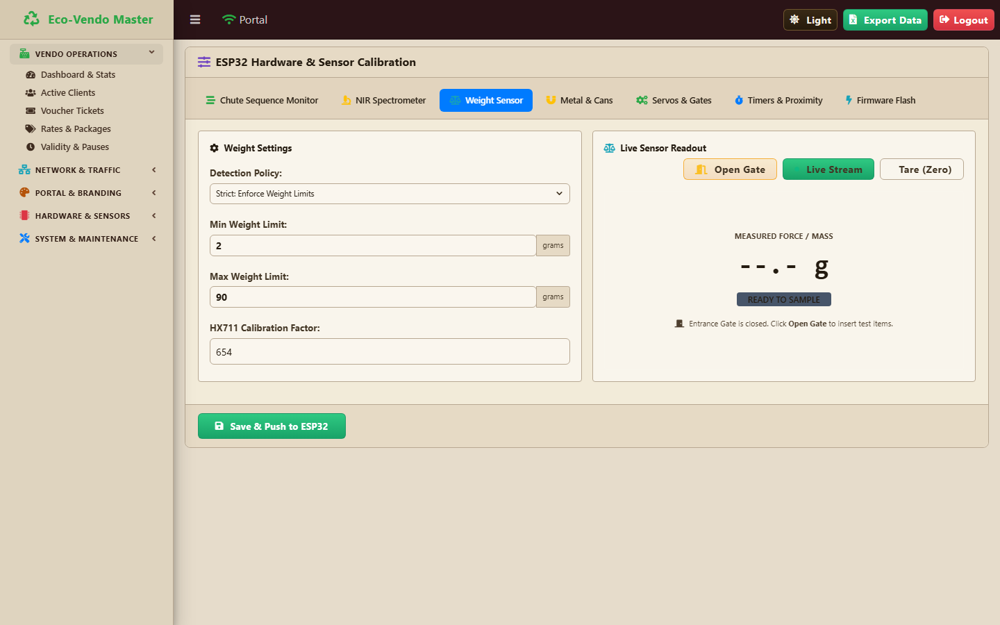

Calibrate the chute load cell (`HX711`):
- **Default Valid Weight Window:** **`2 – 90 g`** with **`Calibration Factor: 654`**.
- Rejects sealed drinks, bottles with leftover water, and heavy objects while passing standard empty PET bottles.
- Click **`Tare (Zero)`** when the cradle is empty to re-zero the scale, or turn on **`Live Stream`** to inspect real-time gram readings.

---

### Metal & Cans (Metal Detector)

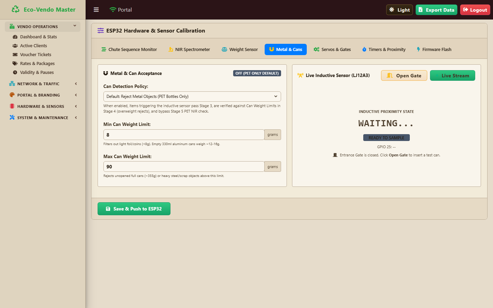

Choose whether the machine rejects all metal or also accepts empty drink cans:
- **Default Mode (`OFF — PET Bottles Only`):** Immediately rejects cans, metal caps, coins, and foil.
- **Optional Can Mode (`Allow Metal Cans`):** Accepts items triggering the inductive sensor as long as they fall inside the separate **`Min Can Weight Limit` (`8 g` default)** and **`Max Can Weight Limit` (`90 g` default)** bounds.
- Use **`Open Gate`** and **`Live Stream`** to check **`CLEAR (NO METAL)`** vs. **`METAL DETECTED`** in real time.

---

### Gate & Drop Motors

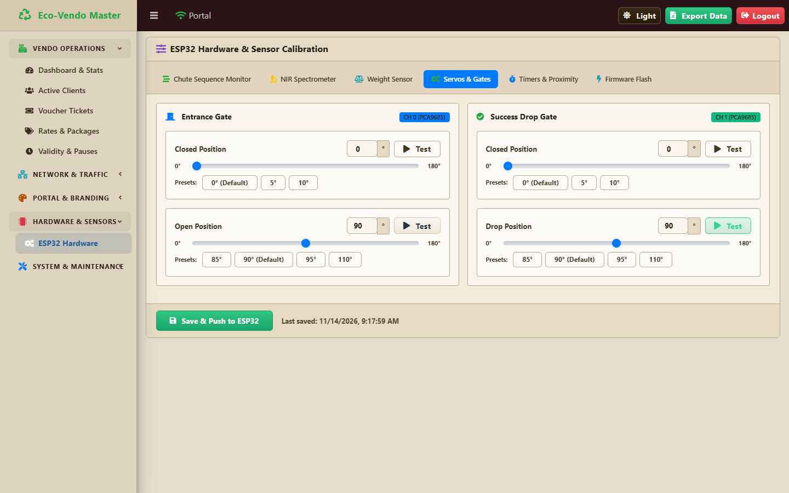

Fine-tune and test both servo doors (**Entrance Gate** and **Bottom Drop Flap**, **`0° / 90°`** defaults) with sliders and test buttons so both doors open and close smoothly without binding.

---

### Timers & Full-Bin Sensor

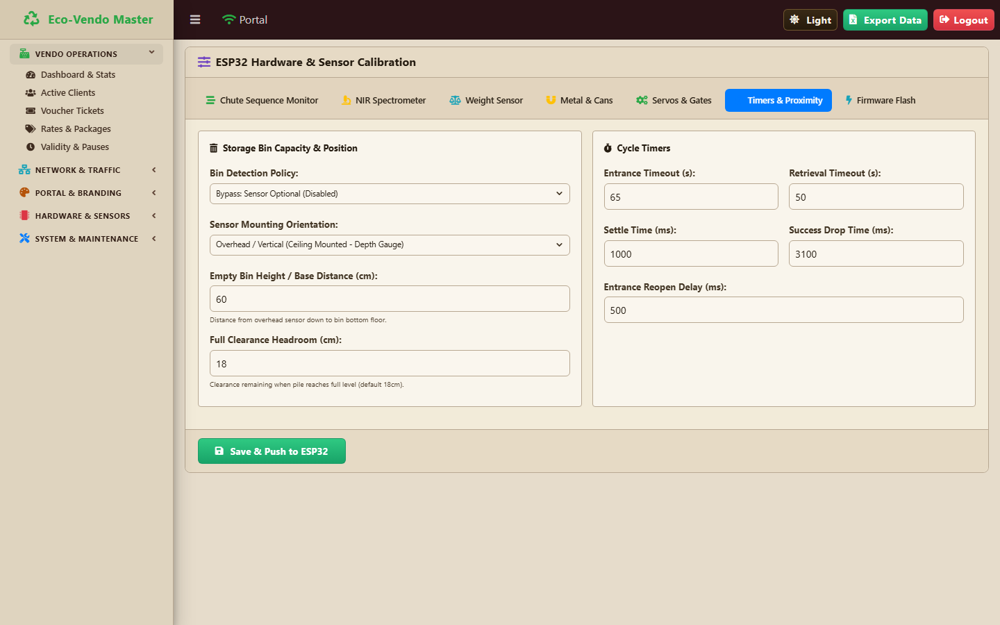

Configure bin-full protection and cycle timings:
- **Storage Bin Sensor:** Pick mounting orientation (**Overhead** or **Horizontal**), empty bin depth (`60 cm` default), and **Full Clearance Headroom (`18 cm` default)** so new deposits pause safely when the collection bin reaches capacity.
- **Cycle Timers (Defaults):**
  - **`Entrance Timeout` (`65 s`):** Window for the user to drop a bottle once the gate opens.
  - **`Retrieval Timeout` (`50 s`):** Time the front door stays open to retrieve a rejected item.
  - **`Settle Time` (`1000 ms`):** Stabilization delay (`1 second`) before weighing and scanning.
  - **`Success Drop Time` (`3100 ms`):** Duration the bottom flap stays open for an accepted bottle to drop safely into the bin.
  - **`Entrance Reopen Delay` (`500 ms`):** Short delay (`0.5 seconds`) after dropping before opening again for the next bottle.

---

## 6. System & Maintenance

### Telegram Phone Alerts

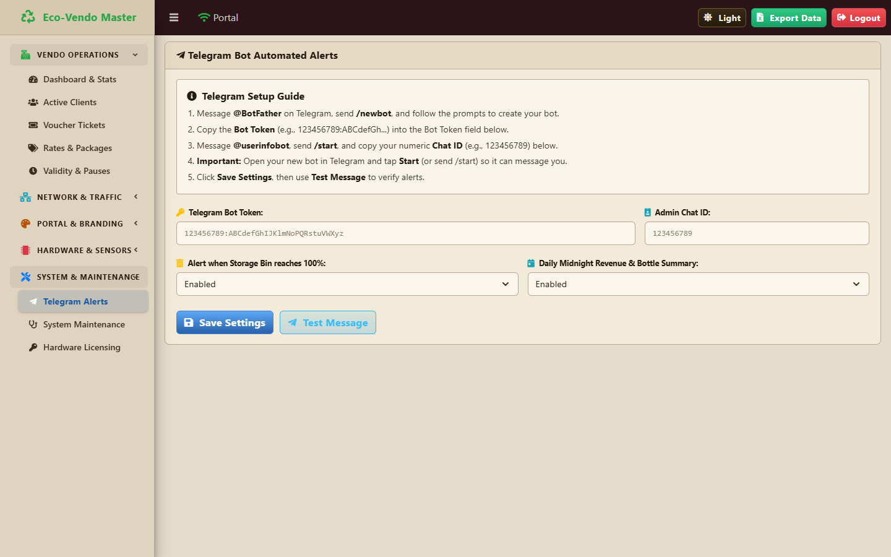

Receive automated Telegram messages on your phone for full-bin warnings or midnight summaries:
1. Create a bot via **`@BotFather`** on Telegram and copy the **Bot Token**.
2. Get your numeric **Chat ID** (for example via `@userinfobot`), and tap **Start** inside your new bot chat.
3. Save both fields in **Telegram Alerts**, toggle the alerts you want, and click **Test Message** to verify delivery.

---

### System Health Check

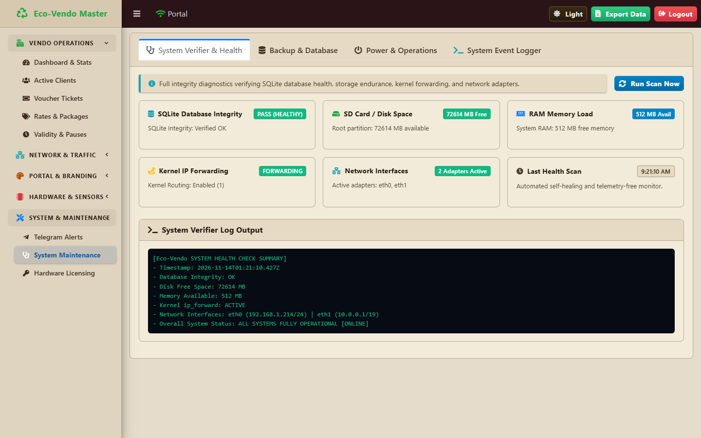

Under **System Maintenance &rarr; System Verifier & Health**, click **Run Scan Now** to verify SQLite database integrity, free disk space, memory availability, Linux IP forwarding, WAN/LAN link status, and ESP32 responsiveness.

---

### Backup, Restore & Reset Data

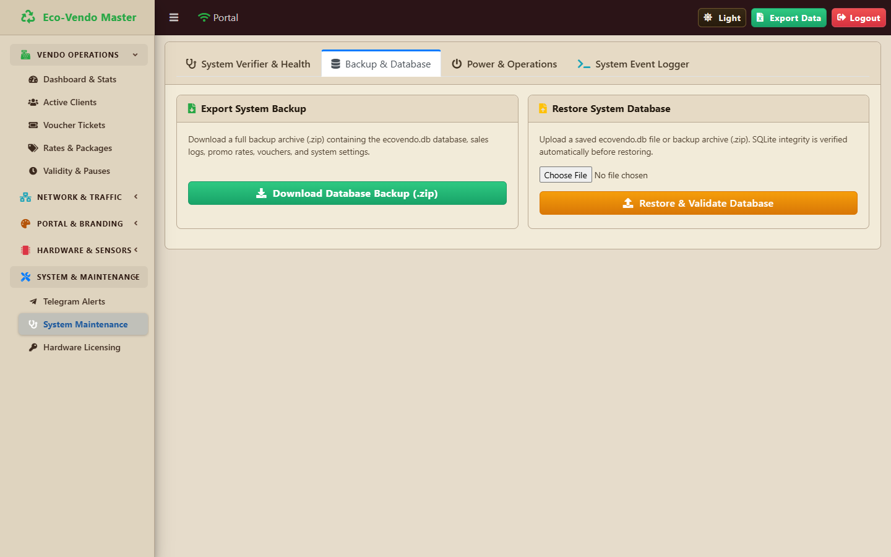

Under **System Maintenance &rarr; Backup & Database**, you can back up, restore, or selectively clear operational records:
- **Export System Backup:** Downloads a `.zip` archive containing your database, intake history, vouchers, rates, and configuration.
- **Restore System Database:** Uploads a saved `.db` or `.zip` backup and runs an automatic SQLite integrity check before restoring.
- **Reset Operational Data (`Reset Dashboard / Data`):** Available both here and as the compact **`Reset Data`** button on the Dashboard chart header. Requires typing **`RESET`** in the confirmation prompt and automatically stays locked while a customer deposit session is open.
  - **Clears ONLY:**
    1. **Dashboard Stats** (`Today's Bottles`, `Lifetime Bottles`, chart history, environmental impact, `WiFi Access & Sessions` counter, and `Peak Usage Window` all reset to `0`).
    2. **Generated Vouchers** (all unused and redeemed voucher codes).
    3. **MAC Filtering Rules** (all VIP Whitelist and Blacklist entries).
  - **Preserved Safely:** ESP32 sensor calibrations (NIR light sensor, HX711 scale, ultrasonic bin settings), gate/servo timings, bottle rates, validity/pause rules, active customer WiFi balances, network/QoS settings, banners/audio, admin login, and commercial license remain untouched.

---

### Restart & Safe Power Off

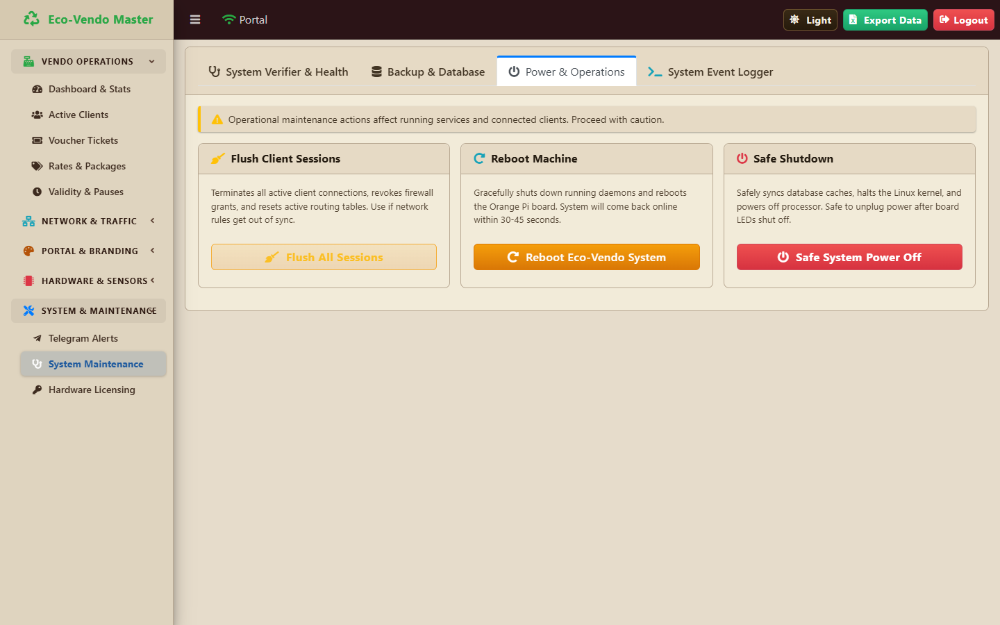

All power and session-reset operations require explicit confirmation:
- **Flush All Sessions:** Signs out all active WiFi clients and clears live firewall authorizations.
- **Reboot Eco-Vendo System:** Cleanly restarts services and reboots the controller.
- **Safe System Power Off:** Flushes SQLite writes and halts Linux safely—**always click this before unplugging power**.

---

### System Activity Logs

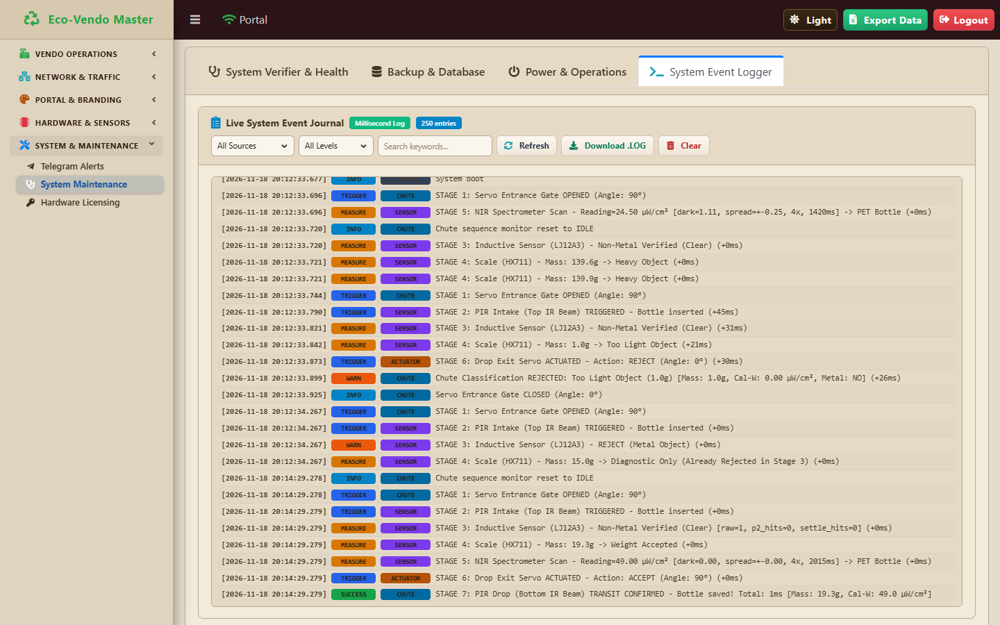

Inspect millisecond-timestamped activity across the portal, chute stages, weight/optical sensors, and system events. Filter by source or severity level, search by keyword, refresh live, download a `.LOG` file, or clear old entries.

---

### Machine License & Remote Support

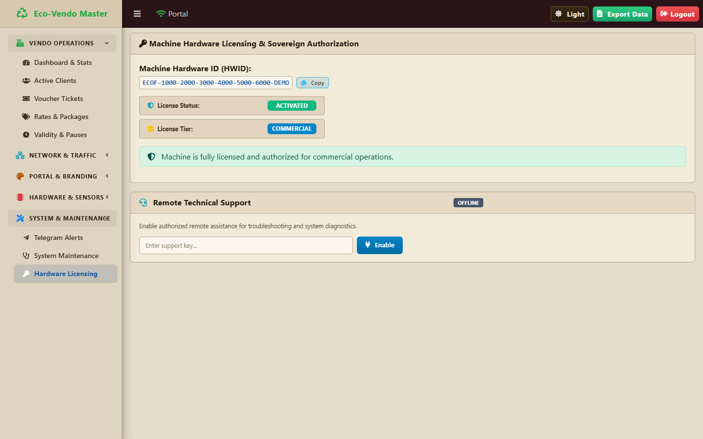

- **Hardware ID (`HWID`):** Displays the unit's 32-character machine code (`XXXX-XXXX-XXXX-XXXX-XXXX-XXXX-XXXX-XXXX`) and current license status (`ACTIVATED` badge once unlocked).
- **Remote Technical Support:** Remains **OFFLINE** by default until explicitly enabled with a temporary support key.

---

## Reference Files

- [How to Connect Customer Poster (PDF)](docs/VMC_EcoVendo_How_To_Connect_Infographic.pdf) · [PNG Version](docs/VMC_EcoVendo_How_To_Connect_Infographic.png) — Printable instruction poster for placement near the machine.
- [ESP32 Hardware & Pinout Reference (PDF)](docs/VMC_EcoVendo_ESP32_Firmware_Reference.pdf) — Annotated microcontroller reference document.
- [AS7263 NIR Calibration Research](docs/AS7263_NIR_CALIBRATION_RESEARCH.md) — Optical material discrimination measurements and calibration notes.
