# VMC ECO-VENDO — Complete User Guide & Operator Manual

**Version:** `2.3.20`

Welcome to the official User Guide and Operator Manual for **VMC ECO-VENDO**, a Bottle-to-WiFi Smart Reverse Vending Machine (RVM) portal and administration suite. This manual walks both everyday WiFi customers and machine operators through every interface in the system.

---

## Table of Contents

- [Part I — Customer WiFi Portal Guide](#part-i--customer-wifi-portal-guide)
  1. [Connecting & Viewing Portal Status](#1-connecting--viewing-portal-status)
  2. [Acceptable vs. Rejected Items](#2-acceptable-vs-rejected-items)
  3. [Depositing Plastic Bottles](#3-depositing-plastic-bottles)
  4. [Managing Active Time (Connected & Paused)](#4-managing-active-time-connected--paused)
  5. [Redeeming a Prepaid Voucher](#5-redeeming-a-prepaid-voucher)
  6. [Sharing & Transferring Time Across Devices](#6-sharing--transferring-time-across-devices)
  7. [Customer Troubleshooting Tips](#7-customer-troubleshooting-tips)
- [Part II — Administrator & Operator Manual](#part-ii--administrator--operator-manual)
  1. [Signing In & First-Boot Security](#1-signing-in--first-boot-security)
  2. [Vendo Operations](#2-vendo-operations)
     - [Dashboard & Stats](#dashboard--stats)
     - [Active Clients](#active-clients)
     - [Voucher Tickets](#voucher-tickets)
     - [Rates & Packages](#rates--packages)
     - [Validity & Pauses](#validity--pauses)
  3. [Network & Traffic](#3-network--traffic)
     - [Adapters & WAN/LAN](#adapters--wanlan)
     - [DNS & Domain](#dns--domain)
     - [DHCP & Leases](#dhcp--leases)
     - [Access Policies](#access-policies)
     - [Bandwidth & Speed + Gaming QoS](#bandwidth--speed--gaming-qos)
     - [Walled Garden Sites](#walled-garden-sites)
     - [MAC Filtering](#mac-filtering)
  4. [Portal & Branding](#4-portal--branding)
     - [Portal & Banners](#portal--banners)
     - [Audio & Chimes](#audio--chimes)
  5. [Hardware & Sensors (ESP32)](#5-hardware--sensors-esp32)
     - [Chute Sequence Monitor](#chute-sequence-monitor)
     - [NIR Spectrometer (AS7263)](#nir-spectrometer-as7263)
     - [Weight Sensor (HX711)](#weight-sensor-hx711)
     - [Servos & Gates (PCA9685)](#servos--gates-pca9685)
     - [Timers & Proximity](#timers--proximity)
     - [Firmware Flash](#firmware-flash)
     - [ESP32 Hardware Simulator](#esp32-hardware-simulator)
  6. [System & Maintenance](#6-system--maintenance)
     - [Telegram Automated Alerts](#telegram-automated-alerts)
     - [System Verifier & Health](#system-verifier--health)
     - [Backup & Database](#backup--database)
     - [Power & Operations](#power--operations)
     - [System Event Logger](#system-event-logger)
     - [Hardware Licensing & Remote Support](#hardware-licensing--remote-support)

---

# Part I — Customer WiFi Portal Guide

The Customer Captive Portal automatically opens when you join the Eco-Vendo WiFi hotspot, or you can open **`http://10.0.0.1/`** in any mobile or desktop browser at any time.

## 1. Connecting & Viewing Portal Status

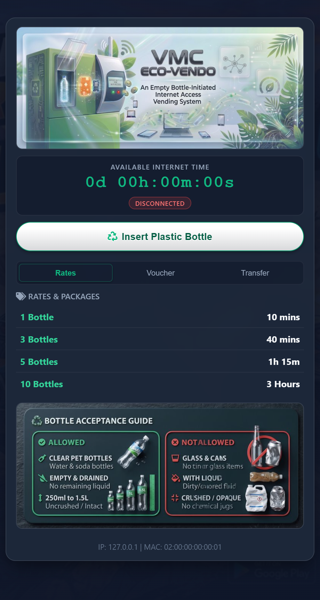

The main portal screen shows:
- **Portal Banner:** Displays the station name (for example, **VMC ECO-VENDO**), tagline, and any active announcement posted by the operator.
- **AVAILABLE INTERNET TIME:** Your remaining internet time formatted as `Dd HHh:MMm:SSs`, paired with your current connection badge:
  - **`DISCONNECTED`**: You do not currently have active internet time on this device.
  - **`CONNECTED`**: Your internet session is active and counting down.
  - **`PAUSED`**: Your remaining time balance is safely held until you resume or reach your auto-resume deadline.
- **Insert Plastic Bottle:** Opens the machine's airlock entrance gate to begin a deposit session.
- **Bottom Feature Tabs:** Switch between **Rates**, **Voucher**, and **Transfer**.
- **Footer:** Displays your device's assigned LAN IP address and hardware MAC address for support reference.

---

## 2. Acceptable vs. Rejected Items

Before opening the bottle chute, review the **Bottle Acceptance Guide** inside the **Rates** tab:

- **Accepted:** Empty, clean PET plastic beverage bottles (without metal caps, liquids inside, or foreign objects).
- **Rejected:** Aluminum/metal cans, glass bottles, cardboard/paper cups, heavy non-bottle objects, or wet/filled bottles.

Inserting non-PET or metallic items triggers the sensor rejection gate so you can retrieve the item safely.

---

## 3. Depositing Plastic Bottles

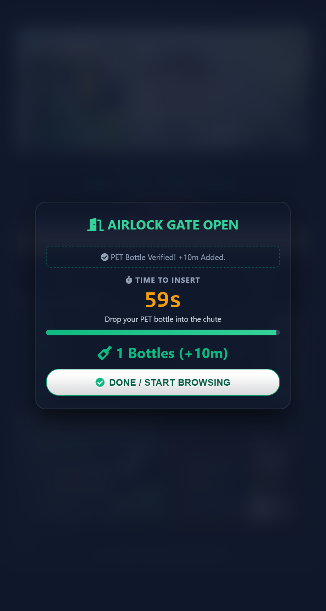

1. Tap **Insert Plastic Bottle** on the portal home screen.
2. Wait for the **AIRLOCK GATE OPEN** prompt to appear along with the gate countdown timer (e.g., `60s` / `58s` window).
3. Insert one empty PET bottle into the chute at a time. Wait for verification and the acceptance chime before inserting the next bottle.
4. Watch the live modal counters update with your **credited bottle count** and **earned WiFi minutes** (including any tiered bonus packages configured by the operator).
5. When finished, tap **DONE / START BROWSING** (or wait for the gate timer to finish) to activate your WiFi access immediately.

---

## 4. Managing Active Time (Connected & Paused)

### Active Session (`CONNECTED`)

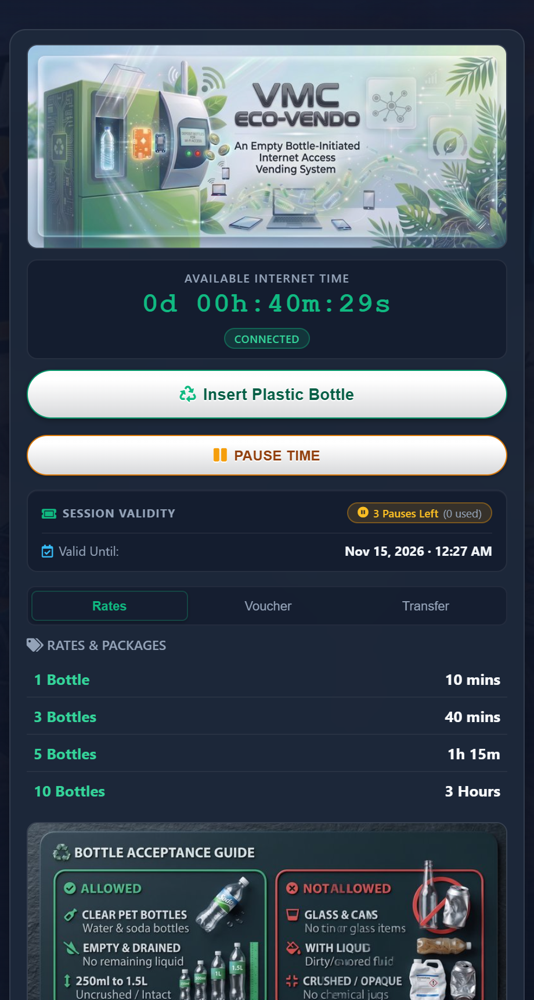

Once credited, your status turns green (**`CONNECTED`**) and your countdown begins. Below your controls, **SESSION VALIDITY** shows:
- Remaining pause allowances (e.g., `3 Pauses Left`) if pausing is enabled by the operator.
- Your session expiration timestamp (**`Valid Until`**).

Tap **PAUSE TIME** whenever you step away and want to conserve your remaining balance (subject to minimum balance and maximum pause limits set by the operator).

### Paused Session (`PAUSED`)

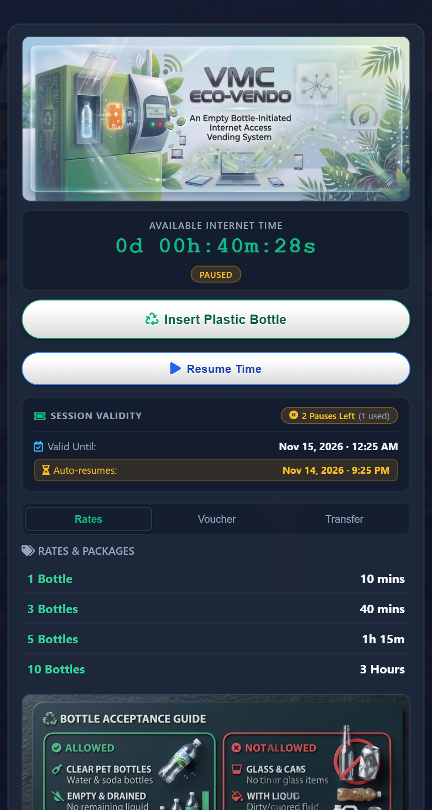

While paused:
- Internet traffic for your device is temporarily blocked and your remaining time stops counting down.
- The **SESSION VALIDITY** panel displays your **`Auto-resumes`** deadline—your session automatically resumes once that deadline passes if you do not resume manually earlier.
- Tap **Resume Time** when you are ready to go back online.

---

## 5. Redeeming a Prepaid Voucher

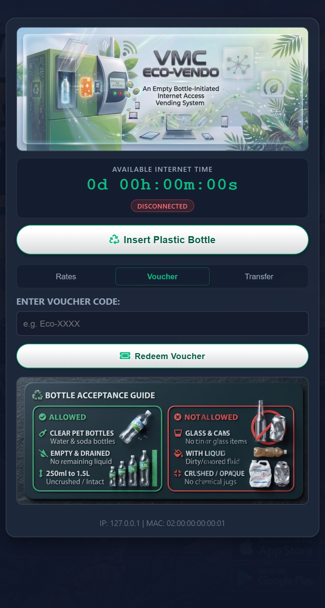

If you received a prepaid voucher code from the operator (formatted such as `Eco-XXXX`):
1. Tap the **Voucher** tab at the bottom of the portal.
2. Enter your voucher code in the input field.
3. Tap **Redeem Voucher** to immediately credit the voucher's duration to your device and start or extend your session.

---

## 6. Sharing & Transferring Time Across Devices

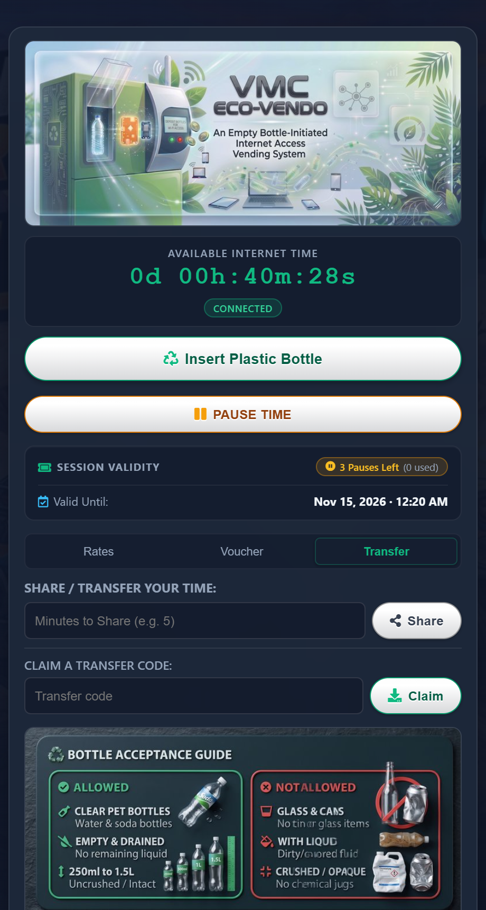

You can move minutes from your current device to another phone, tablet, or laptop on the same Eco-Vendo hotspot:

- **Send / Share Time:**
  1. Open the **Transfer** tab.
  2. Enter the number of minutes to transfer out of your active balance and generate a transfer code.
  3. Share the generated code with the destination device.
- **Claim a Transfer Code:**
  1. On the receiving device, open **`http://10.0.0.1/`** -> **Transfer** tab.
  2. Enter the transfer code in **Claim a Transfer Code** and submit to credit those minutes to the receiving device.

---

## 7. Customer Troubleshooting Tips

- **Portal did not pop up automatically:** Open Chrome, Safari, or another browser and visit `http://10.0.0.1/`. Make sure mobile data is turned off so your phone does not bypass the hotspot gateway.
- **Page briefly disconnects right after pressing DONE or Resume Time:** When internet access opens, your device's firewall state refreshes; wait 1–2 seconds and reload `http://10.0.0.1/` in a regular browser tab if needed.
- **Bottle rejected at the entrance:** Make sure the bottle is completely empty, uncapped (no metal cap), dry, and inserted lengthwise without blocking the chute.

---

# Part II — Administrator & Operator Manual

Access the Admin Control Panel from any device on the Eco-Vendo LAN at **`http://10.0.0.1/admin`**.

The left navigation sidebar organizes every control into **five functional domains**:
1. **VENDO OPERATIONS**
2. **NETWORK & TRAFFIC**
3. **PORTAL & BRANDING**
4. **HARDWARE & SENSORS**
5. **SYSTEM & MAINTENANCE**

---

## 1. Signing In & First-Boot Security

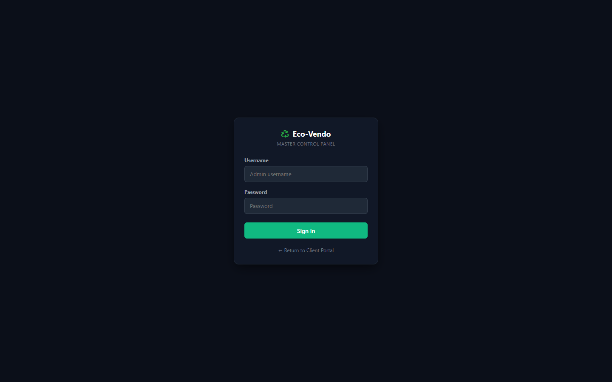

1. Navigate to **`http://10.0.0.1/admin`**.
2. Enter your administrator username and password and sign in.
3. **First-Boot Password Update:** If the system detects initial provisioning credentials on first login, it requires you to set a new custom administrator password before unlocking admin operations. Store your custom password securely and change it periodically under Maintenance.

---

## 2. Vendo Operations

### Dashboard & Stats

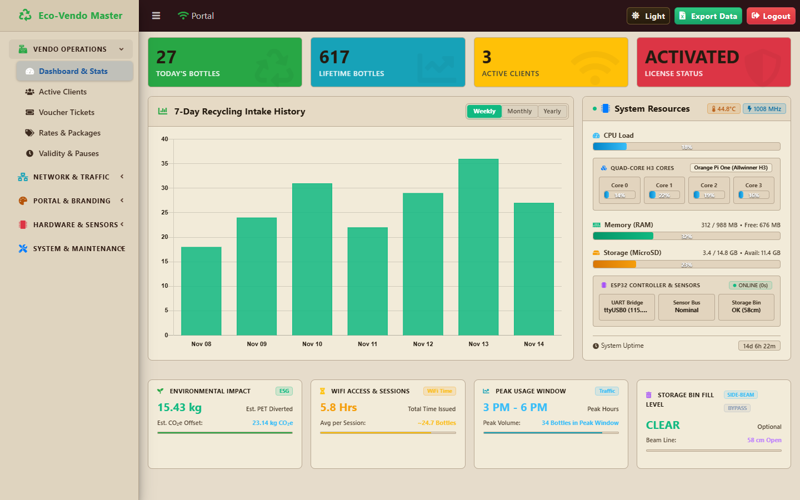

The Dashboard gives operators an immediate overview of machine performance, revenue usage, environmental impact, and hardware health:
- **Top KPIs:** Today's Bottles, Lifetime Bottles, Active Clients, and License Status.
- **Analytics Chart:** Switch between **Weekly**, **Monthly**, and **Yearly** trends for bottle deposits and active usage.
- **System Resources:** Live telemetry for the gateway SBC (CPU load, core count, temperature, frequency, RAM, storage, uptime) alongside the connected **ESP32 Controller** state.
- **Bottom Operational Cards:** Environmental Impact (ESG plastic waste diverted), WiFi Access & Sessions summary, Peak Usage Window, and ultrasonic Storage Bin Fill Level.

---

### Active Clients

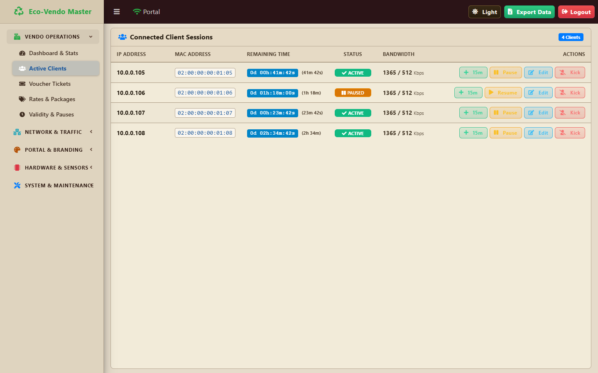

The **Connected Client Sessions** table monitors all authorized and paused customer devices in real time:
- Inspect each client's **IP Address**, **MAC Address**, **Remaining Time**, **Status** (`ACTIVE`, `PAUSED`, `PAID`), and **Bandwidth** cap.
- Perform instant per-client actions (destructive actions require confirmation):
  - **`+15m`**: Grant an extra 15 minutes immediately.
  - **`Pause` / `Resume`**: Temporarily hold or restore internet access for that device.
  - **`Edit`**: Set an exact custom time balance.
  - **`Kick`**: Immediately terminate the client's session and revoke firewall access.

---

### Voucher Tickets

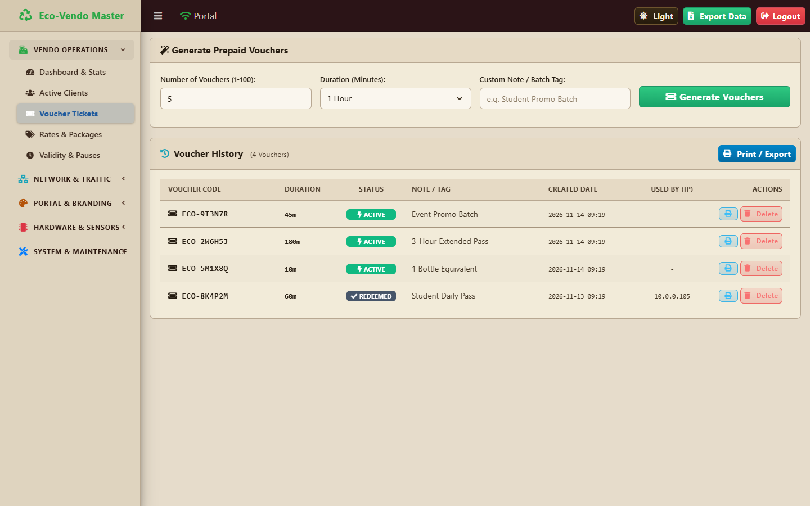

Use **Voucher Tickets** to create and audit prepaid WiFi codes:
- **Generate Prepaid Vouchers:** Select batch quantity (`1–100`) and duration per ticket, then generate ready-to-sell codes.
- **Voucher History:** View unused and redeemed voucher statuses, timestamps, and claiming clients.
- **Print / Export:** Export batches cleanly for printed slips or offline distribution.

---

### Rates & Packages

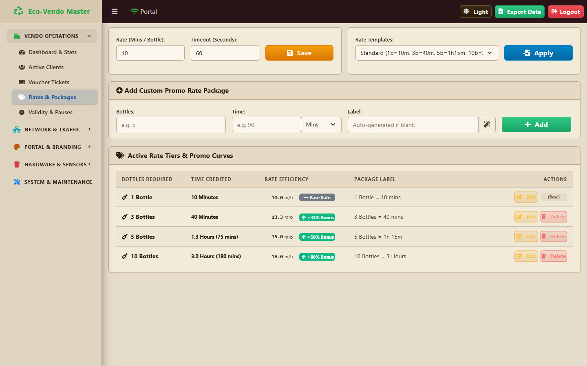

Configure how bottles convert to internet minutes:
- **Base Settings:** Define **Base Rate (Mins/Bottle)** and **Drop Timeout (s)** (how long the airlock gate waits during a deposit session).
- **Rate Templates:** Apply quick presets such as **Standard**, **Aggressive**, or **Cafe** pricing strategies.
- **Custom Promo Rate Package Builder:** Create multi-bottle bonus tiers (for example: `1 Bottle = 10 mins`, `3 Bottles = 40 mins`, `5 Bottles = 1h 15m`, `10 Bottles = 3 Hours`) and view each tier's effective efficiency bonus in the **Active Rate Tiers** table.

---

### Validity & Pauses

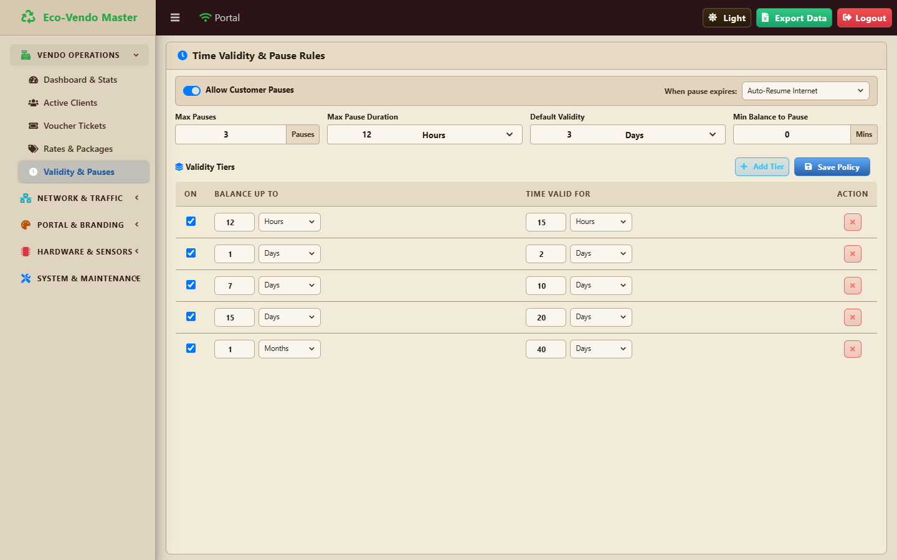

Control expiration windows and pause privileges under **Time Validity & Pause Rules**:
- **Allow Customer Pauses:** Master toggle allowing or restricting client-initiated pauses.
- **Max Pauses:** Maximum number of pauses permitted per session budget (refreshes when new bottles are deposited).
- **Max Pause Duration & Timeout Action:** Define how long a session can remain paused before automatically resuming or expiring.
- **Default Validity & Min Balance to Pause:** Prevent micro-balance abuse and set global expiration rules.
- **Dynamic Validity Tiers:** Define tiered expiration windows scaled to larger bottle deposits or time balances.

---

## 3. Network & Traffic

The **Network & Interfaces** page contains four tabs (**Adapters & WAN/LAN**, **DNS & Domain**, **DHCP & Leases**, **Access Policies**), followed by dedicated Bandwidth, Walled Garden, and MAC Filtering sections.

### Adapters & WAN/LAN

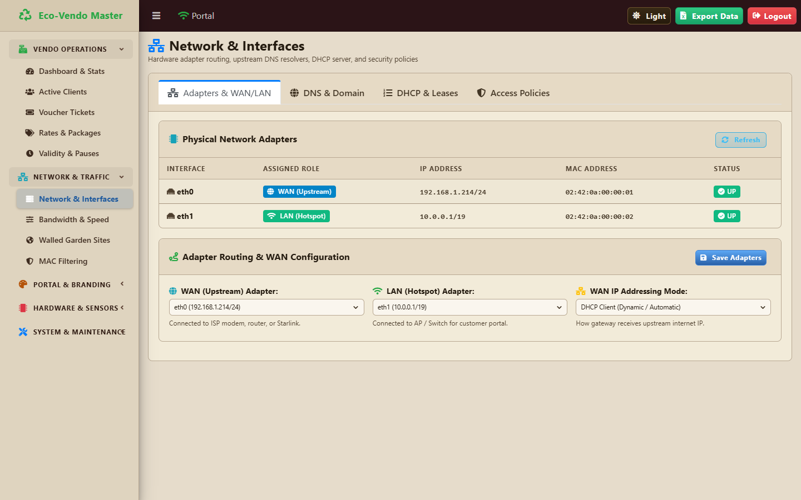

Inspect and assign the upstream **WAN** interface (connected to your ISP router or Starlink Ethernet adapter) and downstream **LAN** interface (connected to your customer WiFi Access Point on subnet `10.0.0.1/19`). Monitor live link state, RX/TX throughput, and gateway assignments.

---

### DNS & Domain

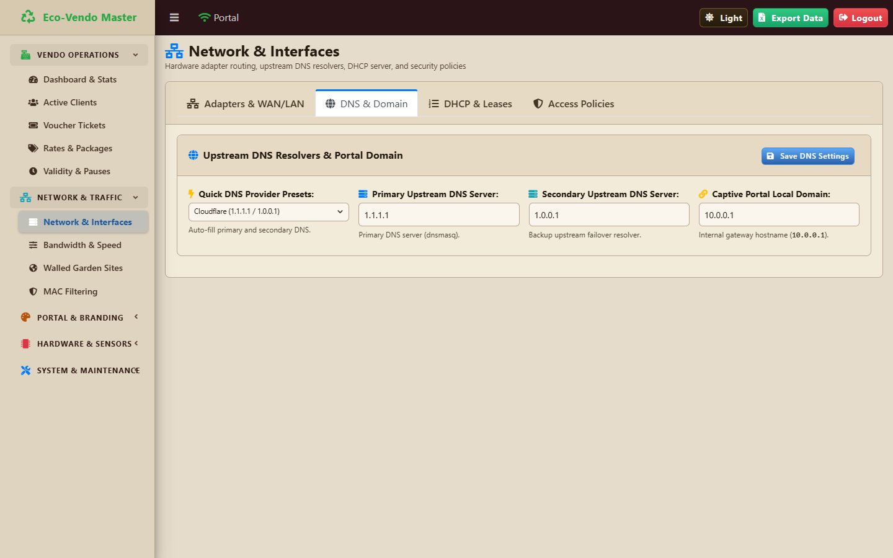

Configure upstream DNS resolvers for authorized internet traffic and captive portal hostname/domain settings. The gateway maintains captive probe interception for Apple CNA (`captive.apple.com`), Android (`connectivitycheck.gstatic.com`), and Windows (`msftconnecttest.com`), as well as RFC 8908 / Option 114 captive portal discovery.

---

### DHCP & Leases

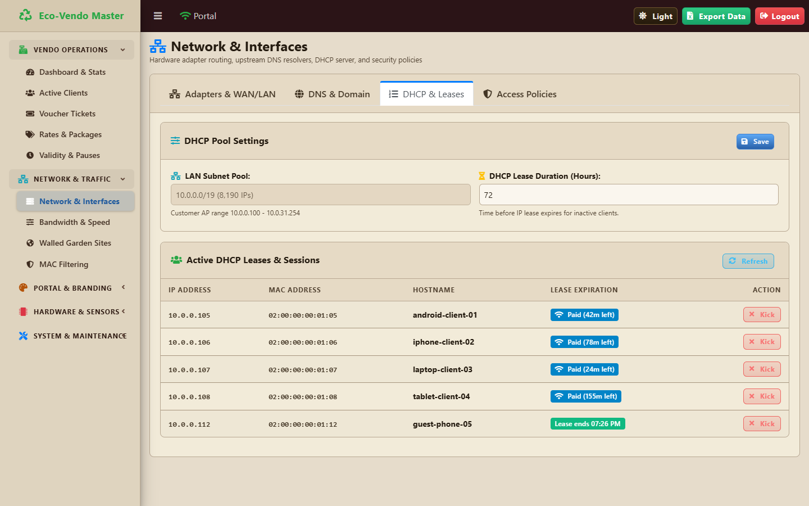

Monitor the local DHCP pool (**`10.0.0.0/19`**, **`8,190 IPs`** available from `10.0.0.100` to `10.0.31.254`). The full-height scrollable IP lease table displays every client's leased IP, MAC address, hostname, lease status, and active session status (such as `Paid (42m left)` or `Unauthenticated`).

---

### Access Policies

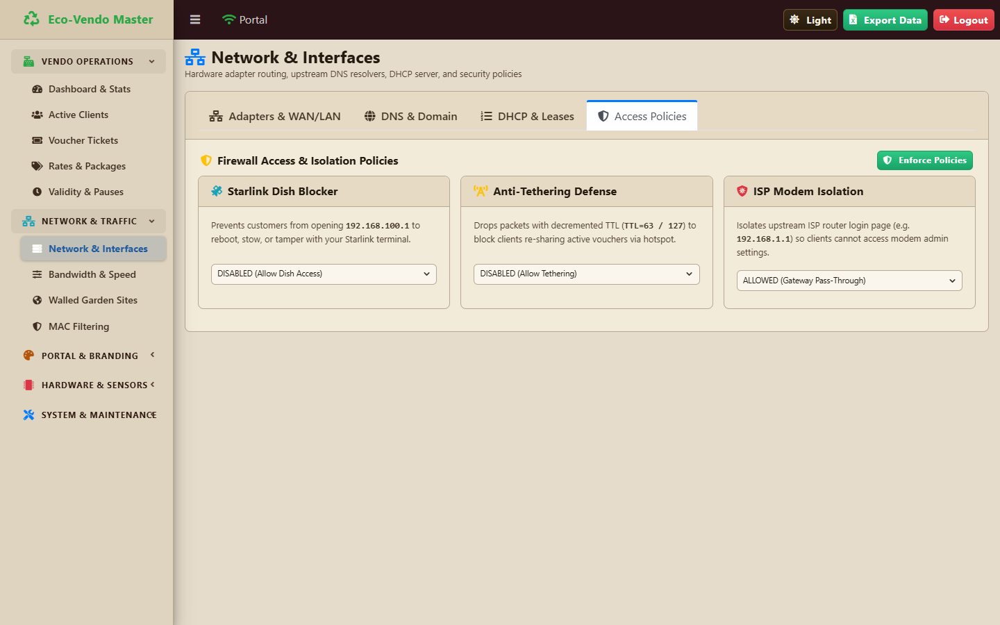

Harden the customer WiFi subnet against unauthorized upstream access and sharing bypasses:
- **ISP Modem Isolation:** Prevents customer devices from reaching upstream router/modem management pages on private RFC 1918 subnets.
- **Starlink Dish Blocker:** Blocks customer LAN access to Starlink dish diagnostics/control endpoints (`192.168.100.1`).
- **Anti-Tethering Defense:** Helps detect and restrict downstream TTL-based hotspot re-sharing from connected client phones.

---

### Bandwidth & Speed + Gaming QoS

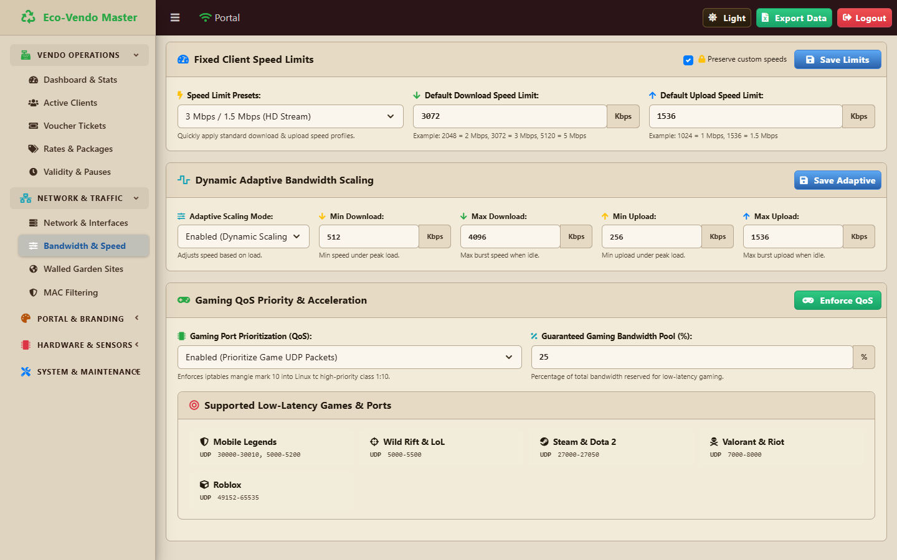

Manage fair bandwidth distribution and low-latency online gaming:
- **Fixed Client Speed Limits:** Set global per-device upload and download speed caps (`Kbps`/`Mbps`) enforced via Linux HTB/SFQ traffic control.
- **Dynamic Adaptive Bandwidth Scaling:** Automatically scales per-client bandwidth caps based on concurrent client load.
- **Gaming QoS Priority & Acceleration:** Prioritizes latency-sensitive UDP traffic into high-priority QoS queues (`1:10`) for supported titles including **Mobile Legends**, **Wild Rift & LoL**, **Steam & Dota 2**, **Valorant & Riot**, and **Roblox**.

---

### Walled Garden Sites

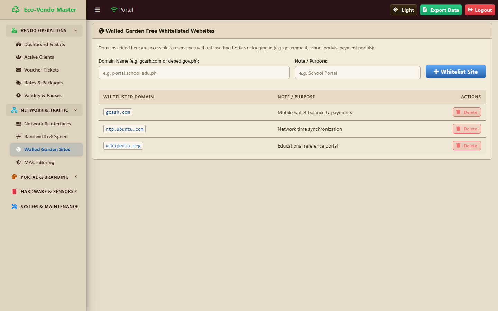

Maintain an allowlist of domain names or hosts that customers may reach **before** earning WiFi time (for example, local informational pages or payment/school portals). Only add trusted destinations here, as listed sites bypass the pre-authentication block.

---

### MAC Filtering

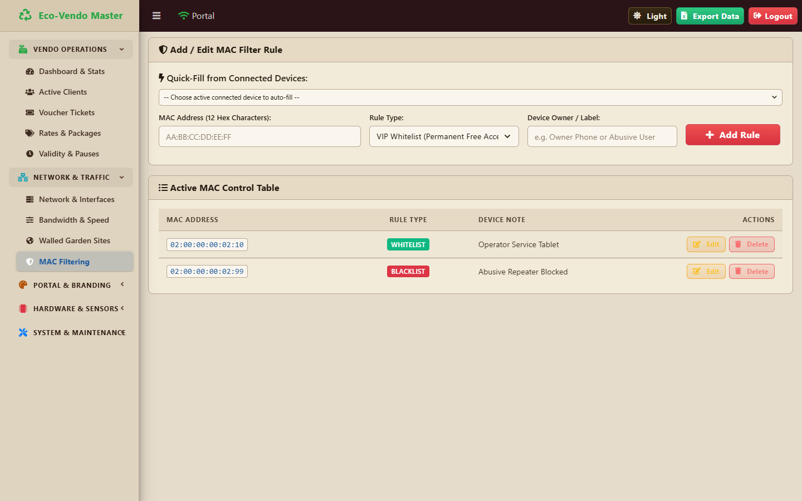

Manage permanent bypass and block rules by hardware MAC address:
- **VIP Whitelist:** Grants continuous internet access to operator devices, kiosk displays, or staff phones without requiring bottle deposits.
- **Blacklist:** Permanently blocks abusive MAC addresses from authenticating or requesting portal access.
- **Quick-Fill from Connected Devices:** Select currently connected LAN clients with one click instead of typing MAC addresses manually.

---

## 4. Portal & Branding

### Portal & Banners

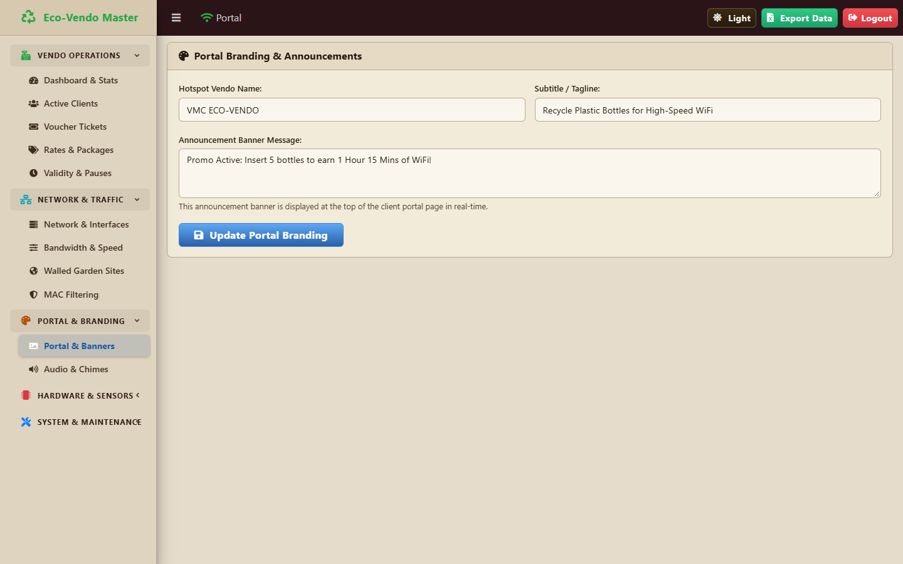

Customize the customer-facing portal appearance in real time:
- **Vendo Name:** Main header title shown on both the portal banner and screen greeting.
- **Subtitle / Tagline:** Short descriptive line under the main heading.
- **Announcement Banner Message:** Broadcast promos, maintenance notices, or house rules directly at the top of the Customer Captive Portal.

---

### Audio & Chimes

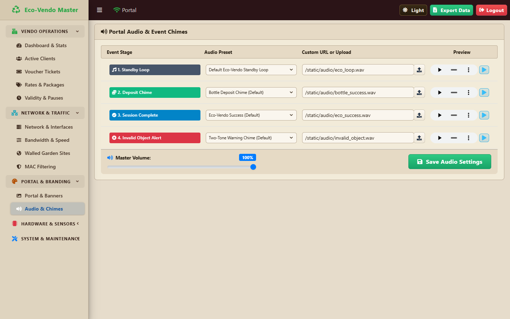

Configure audio feedback across **four distinct event stages**:
1. **Standby Loop:** Background/idle audio behavior.
2. **Deposit Chime:** Plays immediately when a PET bottle passes sensor verification and credits time.
3. **Session Complete:** Plays when the user completes their deposit batch (`DONE / START BROWSING`) or gate session concludes.
4. **Invalid Object Alert:** Audible alert when an unacceptable object (metal, glass, cardboard, or heavy foreign item) triggers rejection.

For each stage, pick a built-in preset, supply a custom audio URL or upload a sound file, test it inline with the preview button, and adjust the **Master Volume** slider.

---

## 5. Hardware & Sensors (ESP32)

The **ESP32 Hardware** workspace provides complete diagnostics, sensor calibration, servo tuning, firmware updates, and a built-in simulator.

### Chute Sequence Monitor

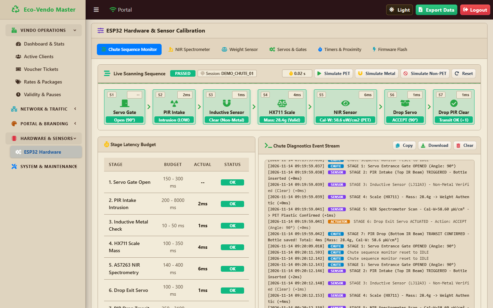

Monitor the real-time **7-Stage Chute Sequence Pipeline (`S1–S7`)** and latency budget from the moment the entrance gate unlocks through object sorting, verification, and drop completion:
- Inspect live stage timing, pass/fail telemetry, and diagnostics stream messages.
- Run built-in **PET**, **Metal**, and **Non-PET** verification simulators directly from the monitor to verify decision logic safely during bench testing.

---

### NIR Spectrometer (AS7263)

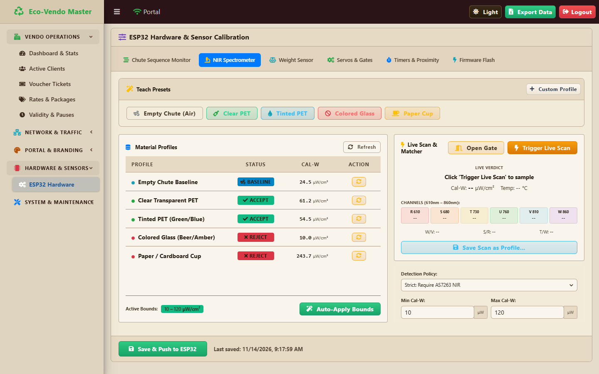

Calibrate the **AS7263 6-Channel Near-Infrared Sensor (`R, S, T, U, V, W`)** used for material discrimination:
- View real-time spectral channel counts and calibrated `W` intensity (`uW/cm²`).
- **Acceptance Window:** Default **NIR `W` range** is **`10 – 120` uW/cm²** (`Cal-W < 22.0` helps identify light-absorbing colored glass, while excessive diffuse scattering `> 220` flags cardboard/paper waste).
- **Teach Presets & Material Profiles:** Capture baseline empty-chute air readings or sample bottle types directly from live sensor telemetry to fine-tune deployments under varying ambient conditions.

---

### Weight Sensor (HX711)

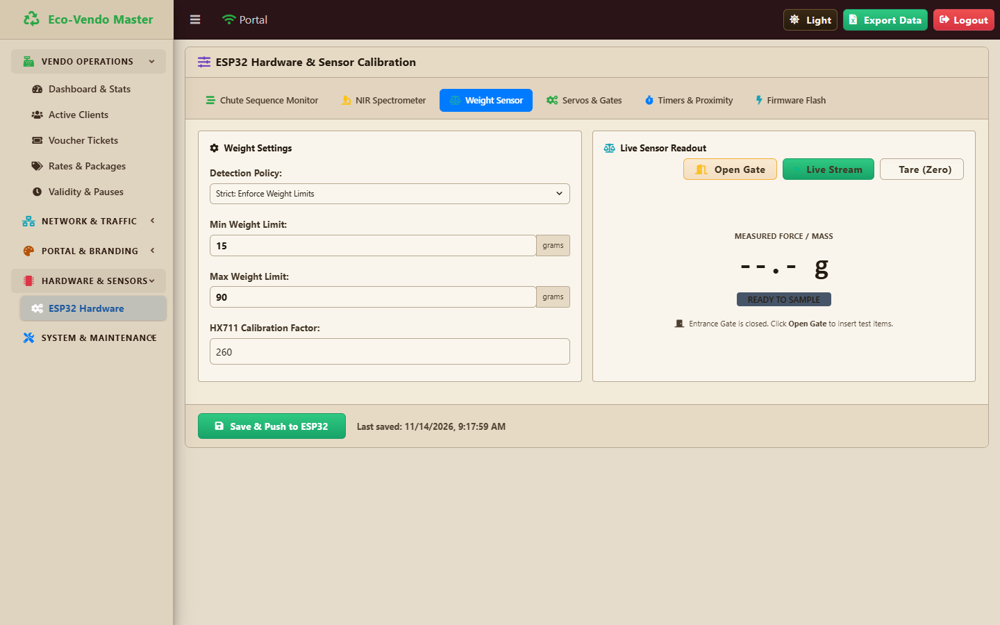

Tune the load-cell cradle connected to the **HX711 ADC**:
- **Weight Window:** Default valid bottle range is **`15 – 90` g** (with default **HX711 calibration factor `260`**).
- **Live Readout & Tare:** Observe real-time trimmed-mean weight measurements (`g`), run a **Zero / Tare** calibration whenever clearing or servicing the weighing cradle, and adjust Min/Max thresholds to accommodate regional bottle sizes while rejecting liquid-filled or heavy foreign objects.

---

### Servos & Gates (PCA9685)

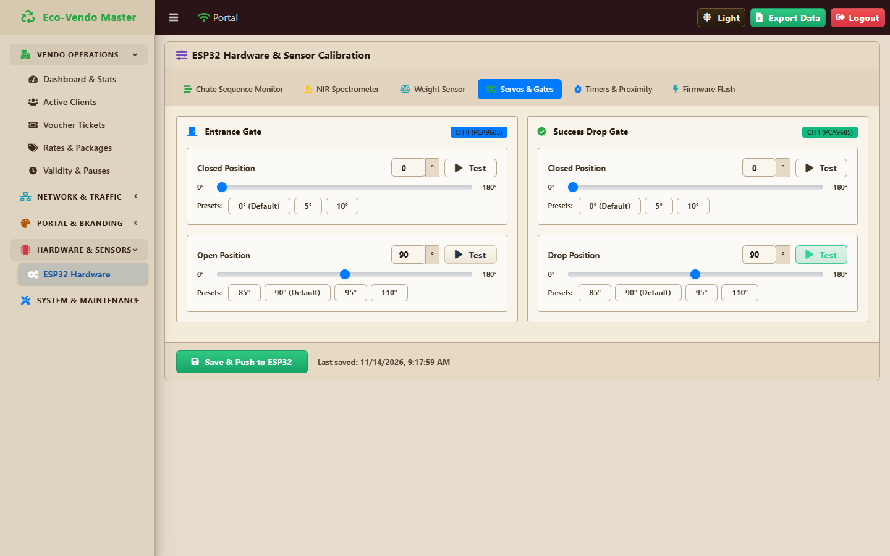

Calibrate mechanical angles on the **PCA9685 PWM Servo Controller**:
- **Channel 0 — Entrance Gate Servo:** Controls customer bottle entry access (standard closed/open angles `0° / 90°`).
- **Channel 1 — Drop Flap / Sorting Gate Servo:** Directs accepted bottles into the storage bin after multi-sensor approval.
- Use the interactive sliders and test buttons to verify smooth mechanical travel without binding or chassis collision before closing the enclosure.

---

### Timers & Proximity

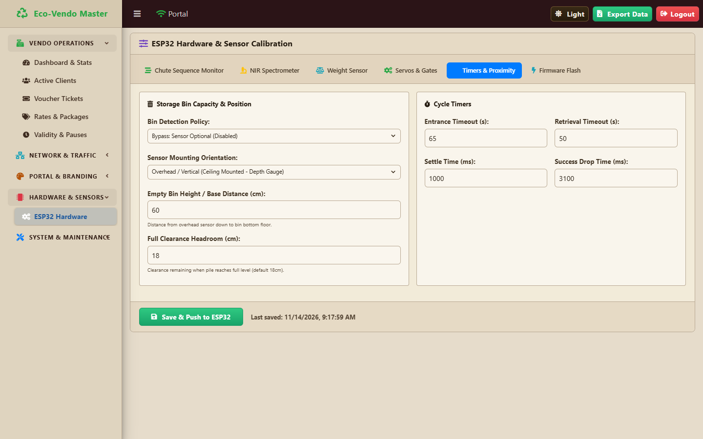

Configure bin fullness sensing and chute state machine timers:
- **Bin Detection Policy & Geometry:** Set enclosure bin orientation (for example, horizontal bin depth **`18 cm`** triggered at **`3 s`** sustained blockage) so the machine automatically prevents overflow and alerts operators.
- **Cycle Timers:** Fine-tune authoritative timing windows (default **Gate `65 s`**, **Settle `1000 ms`**, **Drop `3100 ms`**, **Retrieval `50 s`**) to match physical chute mechanics and anti-crush drop protection.

---

### Firmware Flash

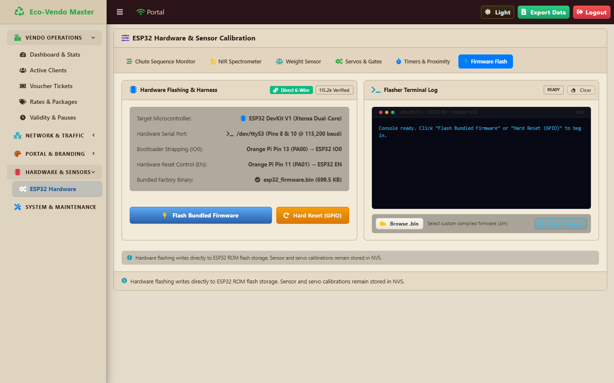

Update the connected ESP32 microcontroller safely without removing it from the machine:
- Review the GPIO strapping / boot pin guidance card before flashing.
- Choose between flashing the **Bundled Firmware** synced with your VMC ECO-VENDO version or uploading a custom compiled **`.bin`** firmware image, then follow the live flashing console output until completion and automatic controller reboot.

---

### ESP32 Hardware Simulator

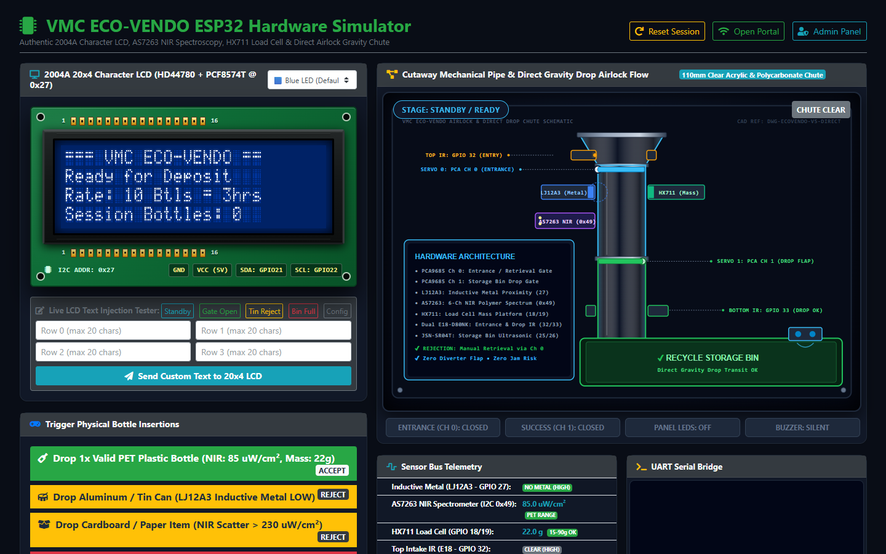

When enabled by an administrator, the authenticated **`/simulator`** route opens the interactive **VMC ECO-VENDO ESP32 Hardware Simulator**:
- Mirrors the physical **20x4 I2C LCD** screen (including rotating rate tiers and drop state messages).
- Displays a live **chute cutaway diagram** showing gate positions and optical/inductive trigger zones.
- Simulates **PET bottle**, **Metal can**, and **Cardboard** drops alongside live NIR/weight sensor telemetry and a streaming **UART serial log** for training, demonstrations, and regression checks without physical hardware attached.

---

## 6. System & Maintenance

### Telegram Automated Alerts

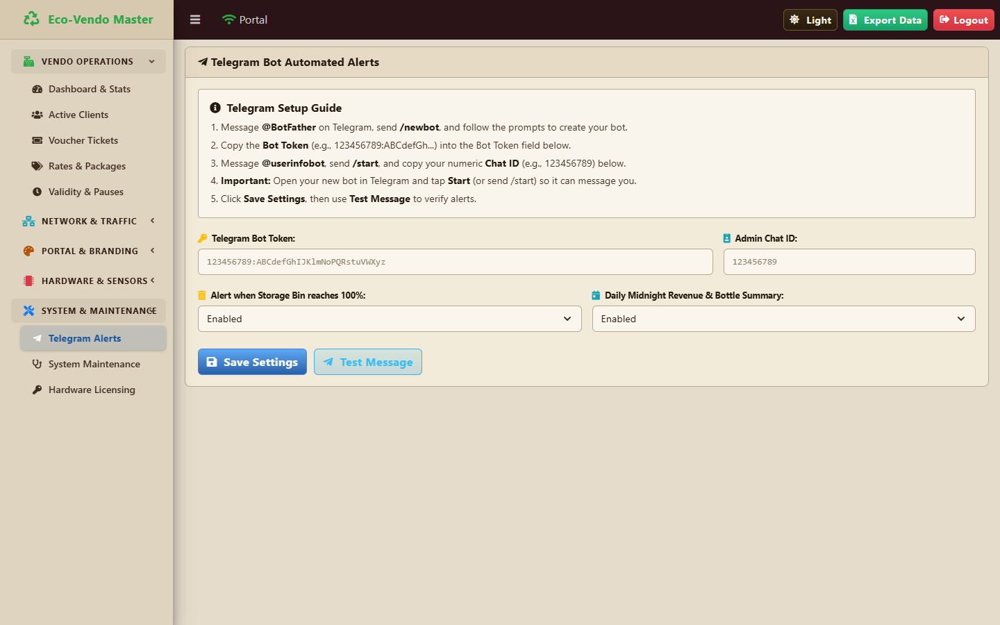

Receive instant mobile alerts from your vending machine via Telegram:
1. Create a bot using **`@BotFather`** in Telegram (`New Bot`) to obtain your **Bot Token**.
2. Retrieve your **Chat ID** (e.g., via `@userinfobot`) and send `/start` to your newly created bot so Telegram permits notifications.
3. Paste both fields into **Telegram Alerts**, toggle **Bin Full Alerts** and/or **Daily Summary Reports**, save, and click **Test Message** to confirm delivery.

---

### System Verifier & Health

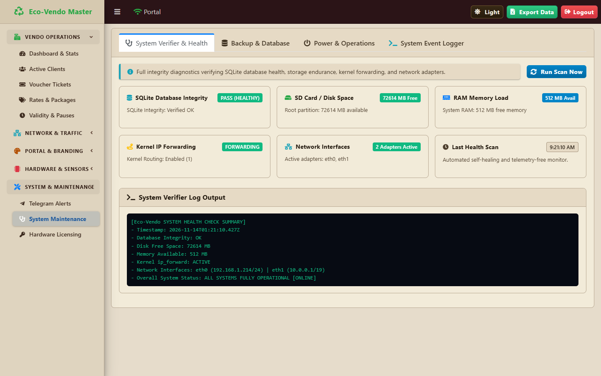

Located under **System Maintenance -> System Verifier & Health**, this tool performs end-to-end checks across portal HTTP routes, SQLite database schema integrity, `dnsmasq`/DHCP/DNS readiness, `iptables`/QoS firewall rules, NTP clock status, and ESP32 serial link health so operators can diagnose issues in one click.

---

### Backup & Database

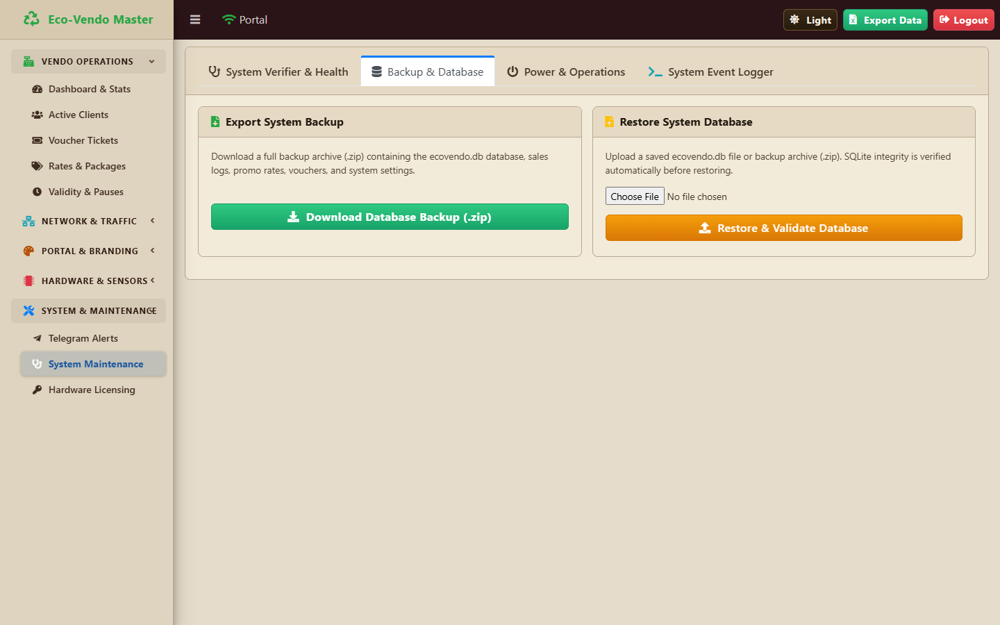

Protect your rates, voucher ledger, client sessions, and configuration:
- **Export System Backup:** Download a compressed `.zip` snapshot containing the SQLite database (`ecovendo.db` / system state), settings, vouchers, and operational records.
- **Restore System Database:** Upload a previously exported `.zip` or `.db` file. Every upload undergoes strict **SQLite integrity verification** before replacing active data.

---

### Power & Operations

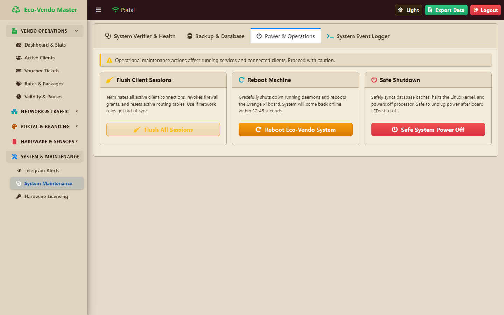

Perform high-impact operational commands safely (each action prompts for explicit confirmation before executing):
- **Flush All Sessions:** Disconnects all currently active clients and resets live firewall grants.
- **Reboot Gateway:** Cleanly restarts the host operating system and portal services.
- **Safe Power Off:** Flushes SQLite writes to disk and powers down the gateway safely prior to unplugging mains power or servicing hardware.

---

### System Event Logger

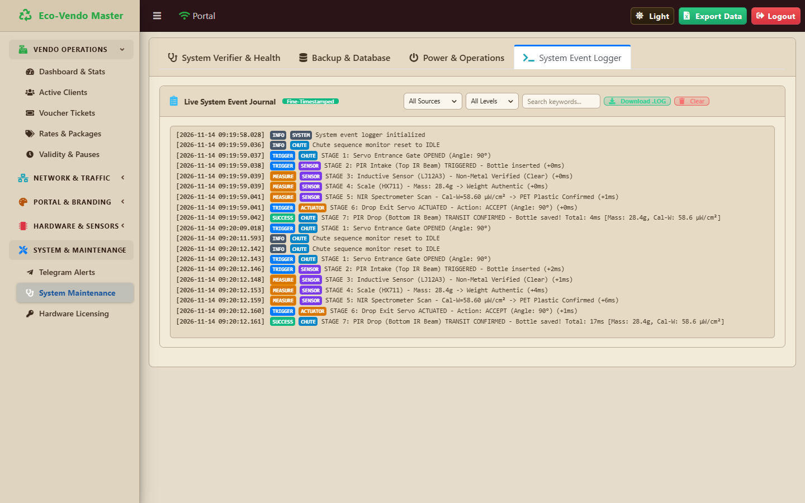

Inspect real-time and historical events from the portal backend, entitlement engine, network firewall, and ESP32 controller:
- Filter log lines by **Source** and **Severity Level** or run a keyword search.
- Download the complete **`.LOG`** archive for offline inspection or clear old entries when archiving logs.

---

### Hardware Licensing & Remote Support

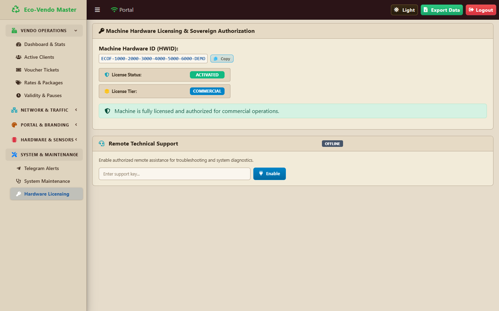

Manage commercial licensing and vendor assistance:
- **Machine Hardware ID (`HWID`):** Copy the unit's unique 32-character (`XXXX-XXXX-XXXX-XXXX-XXXX-XXXX-XXXX-XXXX`) identifier when requesting a commercial license.
- **Commercial Activation:** Enter your vendor-issued Activation Key to license the unit. Once **`ACTIVATED`**, the key entry form is replaced by the verified commercial license badge.
- **Authorized Remote Technical Support:** Remains disabled by default for privacy and security. Only enable this switch when actively troubleshooting with official technical support using the one-time authorization key provided to you.
